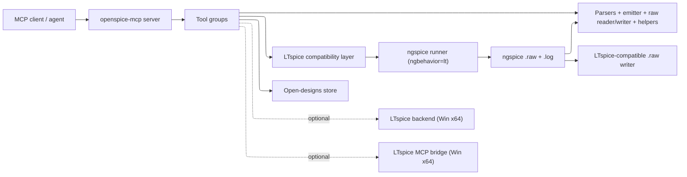
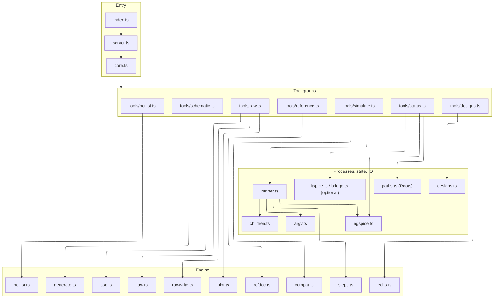
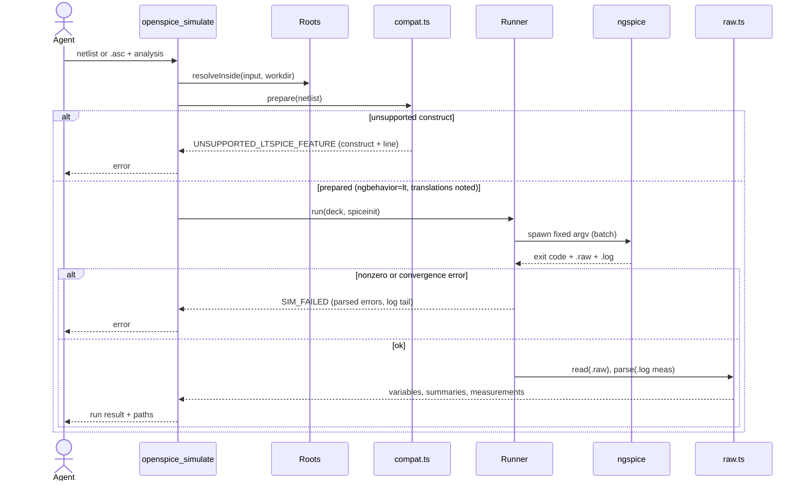
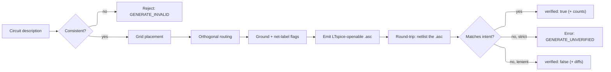
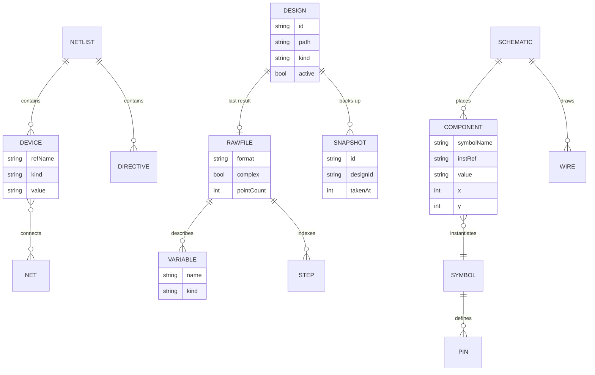
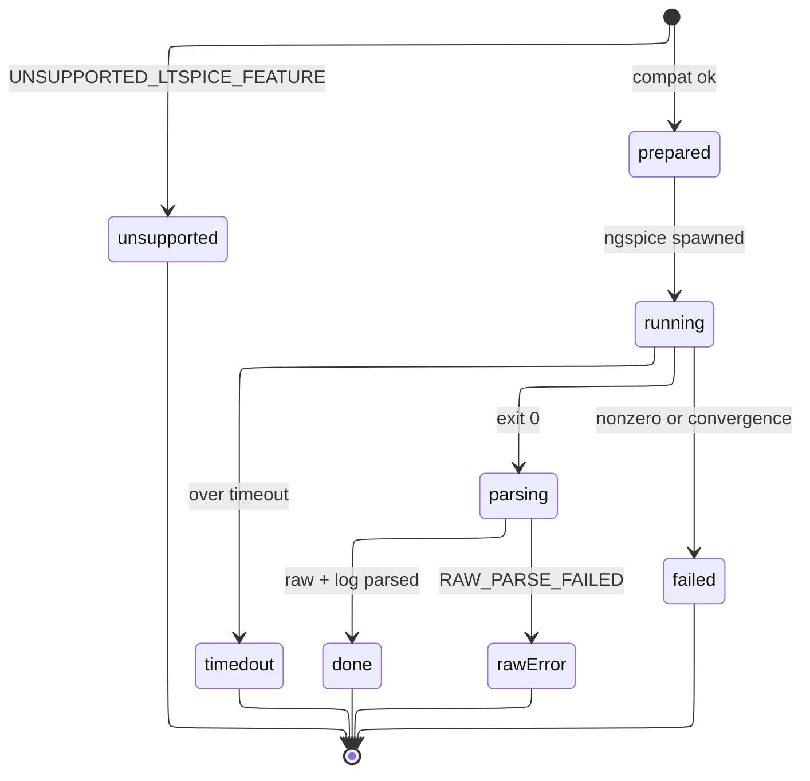
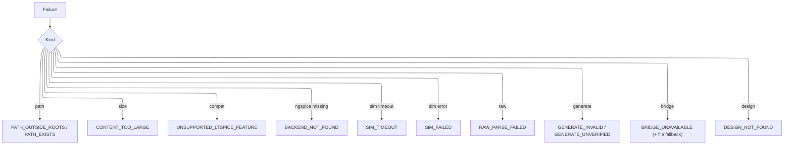

# Design Document

## Overview

OpenSPICE-MCP is an MCP stdio server written in TypeScript (ESM, Node 20+), published as `@sohampatwardhan/openspice-mcp` and run with `npx -y @sohampatwardhan/openspice-mcp@latest`. It gives an agent a fixed, strict set of tools: open/list designs and get/set their content as files; parse/validate SPICE netlists and LTspice `.asc`/`.asy`; convert `.asc` to a netlist; generate a readable LTspice-openable `.asc` from a description and verify it by round-trip; run a simulation with **ngspice**; read the SPICE log, `.raw` metadata, waveforms, measurements, and export them; apply `.meas`/`.step`/parameterize text helpers; list changes; and answer how-to questions from locally available docs.

ngspice is the sole required simulation engine, everywhere and in CI. LTspice is the format inspiration, not a runtime dependency: files OpenSPICE writes must open in LTspice (Requirement 18), but simulation runs on ngspice in LTspice-compatibility mode (`ngbehavior=lt`), with an explicit compatibility layer that translates or clearly rejects LTspice-only constructs (Requirement 15). A native LTspice backend (Requirement 16) and a proxy to ADI's official LTspice MCP bridge (Requirement 17) are optional, Windows-x64-only extras, placed last and never required.

The guiding constraint matches the sibling `kiro-mcp-server`: no shell escape hatch, fixed argv, every path confined to roots (`realpath`), every child tracked and killed, strict schemas with an `outputSchema` on every tool, and `{ "error": { code, message, details } }` on failure. Compatibility settings are written into a per-run file the server owns, never the user's global `.spiceinit`.

The server composes a `Core` bundle (`config`, `roots`, `children`, `ngspice`, `designs`, plus optional `ltspice`/`bridge`) that every tool group receives; tools call core modules and parsers, and core modules never import tools. The engine is a dependency-light pipeline — netlist model, `.asc`/`.asy` model, compatibility layer, step emulator, `.raw` reader/writer, `.asc` emitter, text helpers — wrapped by a thin ngspice runner.

Requirement coverage: R1 `ngspice`/extras probe + `openspice_status`; R2 netlist parser + `openspice_parse_netlist`; R3 `.asc`/`.asy` reader + `openspice_read_schematic`; R4 converter + `openspice_schematic_to_netlist`; R5+R18 generator/writer + `openspice_generate_schematic`; R6+R15 runner + compat layer + `openspice_simulate`; R7+R18 `.raw` reader/writer + `openspice_read_raw`; R8 `Roots`/`argv`/`children`/limits/shutdown; R9 `designs` + `openspice_designs`; R10 `openspice_get_log`/`openspice_raw_info`/`openspice_export_waveforms`; R11 round-trip verifier; R12 helpers + `openspice_netlist_edit`; R13 `refdoc` + `openspice_reference`; R14 the compatibility corpus; R16 optional `ltspice` backend; R17 optional `bridge`.

### Parity with the official LTspice MCP server

Official tool names come from `LTspice.json` and strings in `ltspice-mcp-bridge.exe`; exact schemas are not published, so the mapping is by documented capability. Every official capability maps first to an **ngspice-backed, file-based** OpenSPICE tool; the Windows-x64 bridge is only an optional alternative route for the same tools.

| Official LTspice MCP capability | OpenSPICE tool (ngspice / file-based, default) | Optional alternative |
| --- | --- | --- |
| `list_open_designs` | `openspice_designs` (list) | — |
| `open_design` | `openspice_designs` (open) | — |
| `get_active_design_path` | `openspice_designs` (active) | — |
| `get_design_content` | `openspice_designs` (get_content) | bridge |
| `set_design_content` | `openspice_designs` (set_content, snapshot) | bridge |
| `get_schematic_netlist` | `openspice_schematic_to_netlist` | bridge |
| run sim + read error log | `openspice_simulate` (ngspice) + `openspice_get_log` | LTspice backend / bridge |
| `get_spice_log` | `openspice_get_log` | bridge |
| `get_raw_info` | `openspice_raw_info` | bridge |
| `read_raw_waveforms` | `openspice_read_raw` | bridge |
| `export_raw_waveforms` | `openspice_export_waveforms` (CSV/ASCII) | bridge |
| `list_changed` | `openspice_designs` (list_changed, cursor) | bridge |
| `list_ltspice_reference_docs` / `get_ref` | `openspice_reference` (list / get) | bridge |
| add `.meas`, parameterize, `.step` (text) | `openspice_netlist_edit` | bridge |
| explain schematic / netlist | `openspice_read_schematic` + `openspice_parse_netlist` | — |
| **Beyond official** — generate `.asc` with round-trip verification | `openspice_generate_schematic` (R5, R11) | — |
| **Beyond official** — in-process `.raw` parsing + LTspice-compatible raw writer | `openspice_read_raw`, `openspice_raw_info` (R7, R18) | — |
| **Beyond official** — macOS, Linux, Windows ARM64 (ngspice everywhere) | all tools | — |
| **Beyond official** — LTspice compatibility layer with clear unsupported errors | all run paths (R15) | — |

### Decisions

| Decision | Why | Rejected |
| --- | --- | --- |
| ngspice is the only required engine, everywhere and in CI | Owner's decision: ngspice suffices; LTspice was inspiration | Requiring LTspice |
| Files OpenSPICE writes must open in LTspice (R18); simulation uses ngspice | Interchange with LTspice without depending on it at runtime | ngspice-only formats that LTspice rejects |
| LTspice compatibility via a per-run `.spiceinit`/control block (`ngbehavior=lt`, `ltps`/`ltpsa`) | Isolates settings to the run; never touches the user's global config (R8.5) | Editing the user's `~/.spiceinit` |
| Translate LTspice-only constructs when safe, else `UNSUPPORTED_LTSPICE_FEATURE` naming construct + line | Correctness over silent divergence | Running an unknown construct and hoping |
| `.step` emulated via an ngspice control loop (`let`/`alter`/`foreach`) assembling a stepped raw | ngspice has no `.step`; emulation keeps the LTspice workflow | Dropping `.step` support |
| LTspice native backend and the bridge are optional, Windows-x64-only, listed last | Owner: clearly secondary, never required | Treating them as co-equal backends |
| Bridge default `--headless`; GUI attach (`--pid`/`--port`, loopback) only on explicit request | Deterministic by default; live edits only when asked (resolves prior open question) | Preferring an attached GUI |
| Mirror `kiro-mcp-server` layout, tsconfig, CI, release, and skills | Owner's sibling repo; proven publish path | A fresh project shape |
| Runtime deps `@modelcontextprotocol/sdk` + `zod` only; parsers/codecs in-repo | Sibling's lean rule; formats are small | A JS SPICE library |
| `.asc` generation always round-trips (netlist, compare); strict mode fails on mismatch | ADI: AI draws schematics badly; this is the differentiator | Trusting generated geometry |
| Reference tool indexes local docs + OpenSPICE docs + ngspice pointers; bundles no ADI docs | Help answers without redistributing copyrighted content | Shipping ADI help |
| Ship a minimal open symbol set; resolve user symbols from paths / LTspice `sym` if installed | `.asc`→netlist works without LTspice installed | Requiring LTspice's symbol library |
| `.raw` arrays downsampled to `maxPoints`; summaries always returned | Transients hold millions of points | Returning every raw sample |
| Mark every unconfirmed format/compat detail as **uncertain** in docs and results | Format claims must be accurate, not guessed | Asserting unverified byte layouts |

## Architecture

The process entry (`src/index.ts`) loads config (exit 2 on a config error), opens the stdio transport, registers tool groups, and wires shutdown. `src/server.ts` is the composition root. Tool groups live one-file-per-group under `src/tools/`. Engine modules (`netlist`, `asc`, `generate`, `raw`, `rawwrite`, `compat`, `steps`, `plot`, `edits`, `refdoc`) are pure where possible. The file-based session lives in `designs.ts`. Only `ngspice`, `children`, and the optional `ltspice`/`bridge` touch processes; only `runner` sequences a simulation. `argv.ts` is the single place a command vector is built; `children.ts` the single module that spawns and signals processes (detached, `shell: false`, tracked, group-killed).

A successful ngspice run (with compatibility) and a rejected one:

## Components and Interfaces

### Roots (`src/paths.ts`)

Resolves every path with `realpath` and rejects anything outside the roots before any read, write, or spawn (R8.1). `resolveInside`, `ensureWritable(path, overwrite)` (`PATH_EXISTS`), `makeRunDir`, `snapshotDir`. Mirrors the sibling's `Roots`.

### ngspice runner and compatibility (`src/ngspice.ts`, `src/argv.ts`, `src/compat.ts`, `src/steps.ts`, `src/runner.ts`)

`ngspice.ts` detects ngspice, reports path, version, and whether the version meets the minimum for `ngbehavior=lt` (R1). `argv.ts` builds the only ngspice vector: batch `-b` with `-r <raw>` and `-o <log>`, pointed at the prepared deck. `compat.ts` builds the per-run `.spiceinit`/control block (`set ngbehavior=lt`; `ltps`/`ltpsa` when PSpice-style libraries are pulled in), translates safe LTspice-only constructs, and raises `UNSUPPORTED_LTSPICE_FEATURE` otherwise (R15). `steps.ts` emulates `.step` with an ngspice control loop and assembles a stepped raw (R6.3). `runner.ts` prepares the run dir, spawns, enforces the timeout, classifies the exit into success/`SIM_FAILED`/`SIM_TIMEOUT`, and stops processes (R6).

`ngspice minimum version:` `ngbehavior=lt` has existed in ngspice for several major releases; a safe stated floor is **ngspice 34 (2021)**, with newer releases preferred for the `ltpsa` handling. **Uncertain**: the exact first release that introduced each of `lt`/`ltps`/`ltpsa` is not confirmed here; the status tool reports the found version and marks the requirement as "34+ (uncertain; verify against the ngspice manual for the host)".

### Netlist engine and text helpers (`src/netlist.ts`, `src/edits.ts`)

`parse`, `validate`, `emit` (R2). `edits.ts`: `addMeas`, `addStep`, `parameterize` over netlist text, each returning edited text or an absent-target diagnostic, never simulating (R12).

### Schematic engine, generator, round-trip, and symbols (`src/asc.ts`, `src/generate.ts`)

`readAsc`, `readAsy`, `toNetlist` (R3, R4), with symbol resolution from the bundled open set, a configured search path, or the user's LTspice `sym` folder only when installed and allowed (R4.2). `generate.ts`: `generateAsc(circuit)` places, routes, flags, emits LTspice-openable `.asc` bytes (R18.1), then round-trips (netlist the output, compare connectivity) returning `verified`/`GENERATE_UNVERIFIED` (R11).

### Open-designs store (`src/designs.ts`)

In-memory file-based session (R9, R10 association, change list): `open`, `list`, `active`, `getContent`, `setContent` (validate → optional snapshot → write in LTspice-openable bytes), `restore`, `listChanged(cursor)`. Associates each design with its latest `.raw`/`.log`.

### Raw reader and LTspice-compatible writer (`src/raw.ts`, `src/rawwrite.ts`, `src/plot.ts`)

`raw.ts` `readRaw` sniffs ngspice Berkeley rawfiles and LTspice binary; `summarize`, `parseMeas`, `rawInfo`, `exportWaveforms` (CSV/ASCII) (R7, R10). `rawwrite.ts` writes an LTspice-compatible `.raw` and keeps ngspice's original (R18.2, R18.3). `plot.renderPlot` writes an SVG when enabled (R7.7).

### Optional extras (`src/ltspice.ts`, `src/bridge.ts`)

`ltspice.ts` (R16): on Windows x64, detect a native LTspice executable and run native batch when explicitly selected. `bridge.ts` (R17): detect `ltspice-mcp-bridge.exe`, run it as an MCP client subprocess when delegation is enabled, forward supported ops `--headless` by default (`--pid`/`--port` only on explicit live-GUI request), and map failures to `BRIDGE_UNAVAILABLE` with file-based fallback. Both are disabled by default and never on the required path.

### Tool groups (`src/tools/*.ts`)

| Tool | Requirement | Purpose |
| --- | --- | --- |
| `openspice_status` | 1, 16, 17 | ngspice (path, version, compat-mode support), roots, plotting flag, optional-extras availability, warnings |
| `openspice_parse_netlist` | 2 | Parse + optionally validate (path or inline) |
| `openspice_read_schematic` | 3 | Read an `.asc`/`.asy` |
| `openspice_schematic_to_netlist` | 4 | Convert `.asc` to a netlist |
| `openspice_generate_schematic` | 5, 11, 18 | Generate LTspice-openable `.asc` and round-trip verify |
| `openspice_designs` | 9, 10(assoc) | open / list / active / get / set / snapshot / restore / list_changed |
| `openspice_netlist_edit` | 12 | `.meas` / `.step` / parameterize helpers |
| `openspice_simulate` | 6, 15 | Run ngspice with compatibility (optionally LTspice/bridge) |
| `openspice_read_raw` | 7, 18 | Parse `.raw`, summaries, measurements, optional LTspice-raw + plot |
| `openspice_raw_info` | 10 | `.raw` metadata only |
| `openspice_export_waveforms` | 10 | Export to CSV/ASCII |
| `openspice_get_log` | 10 | SPICE log / parsed errors |
| `openspice_reference` | 13 | list / get local + OpenSPICE + ngspice docs |

Bridge-capable tools accept an optional `delegate` flag; `openspice_simulate` accepts an optional `backend` (`ngspice` default, `ltspice` when enabled). Every tool has a strict Zod input schema (`additionalProperties: false`), an `outputSchema`, and returns `structuredContent`.

## Data Models

Simulation run lifecycle (compatibility prepare → ngspice → parse):

Illegal transitions: a netlist with an unsupported construct never reaches `running`; a `failed`/`timedout` run never yields success (R6.6); the run dir is cleaned and processes stopped on leaving `running` (R6.7); `set_content` never writes on a parse error (R9.6).

## LTspice compatibility

ngspice runs LTspice-flavoured decks in LTspice mode (`set ngbehavior=lt`, written to a per-run `.spiceinit`/control block; `ltps`/`ltpsa` added when PSpice-style libraries appear). For each LTspice-only construct the layer either translates it (noted in diagnostics) or fails with `UNSUPPORTED_LTSPICE_FEATURE` naming the construct and line. Items marked **uncertain** need confirmation against the ngspice manual for the host version; the implementation (task 8/16) must verify each before claiming support, and the corpus (Requirement 14) pins the behavior.

| Construct | ngspice behaviour | Our action | Certainty |
| --- | --- | --- | --- |
| Voltage-controlled switch `SW` + `.model SW(Ron Roff Vt Vh)` | ngspice has `SW` with `vt/vh` hysteresis; parameter/semantics differ slightly from LTspice | Translate params to ngspice `SW`; warn on hysteresis edge cases | uncertain |
| B-sources (behavioural `B`) | Supported; most arithmetic/boolean operators overlap | Pass through; validate functions against the supported set | high |
| LTspice fns `uramp`, `limit`, `buf`, `inv` | Commonly available in ngspice B-source syntax | Pass through | medium |
| LTspice fns `table`, `idt`/`sdt`, `delay`/`absdelay`, `ddt` | Partial/variant support; `idt`/`delay` semantics differ | Translate where a documented equivalent exists, else `UNSUPPORTED_LTSPICE_FEATURE` | uncertain |
| A-devices (`DIFFSCHMITT`, `SAMPLEHOLD`, `MODULATE`, special fns) | Not present in ngspice | `UNSUPPORTED_LTSPICE_FEATURE` (construct + line) | high |
| `.options plotwinsize`, `numdgt`, `measdgt` | Ignored or named differently | Drop with a note; map `measdgt`→measurement formatting where possible | medium |
| `.options` / `.tran` `maxstep`, startup/`uic`/steady modifiers | `uic` supported; `maxstep` and startup semantics differ | Translate `uic`/`maxstep`; warn on startup/steady differences | uncertain |
| `.step` | No native `.step` | Emulate via control loop (`alter`/`let`/`foreach`), assemble stepped raw | high (design), impl pending |
| `.meas` (FIND/WHEN/AT, TRIG/TARG) | ngspice `meas` is mostly compatible | Translate `.meas`→ngspice `meas`; warn on unsupported clauses | medium |
| `.four` | Supported; output formatting differs | Pass through; normalize parsed output | medium |
| `.wave` (WAV export) | ngspice uses `wrdata`/`write`, not `.wave` | Translate to a `write`-based export, else `UNSUPPORTED_LTSPICE_FEATURE` | uncertain |
| `.net` / `.tf` | ngspice has `.tf`; `.net` (network params) differs | Pass `.tf`; `UNSUPPORTED_LTSPICE_FEATURE` for `.net` unless confirmed | uncertain |
| `.machine` state machines | Not present in ngspice | `UNSUPPORTED_LTSPICE_FEATURE` | high |
| Encrypted/proprietary vendor `.lib` (e.g. ADI op-amp models) | Cannot be read/run by ngspice | `UNSUPPORTED_LTSPICE_FEATURE`: require an open user-supplied model; never shipped | high |
| `Rser`/`Cpar` instance params on L/C/V | lt-mode support partial | Translate to series R / parallel C sub-elements where safe, else warn | uncertain |
| LTspice standard libs (`standard.dio/.bjt/.mos`) | Not bundled with ngspice | Read from user's LTspice install if present+allowed, else require a model and report which | medium |
| `.asy` symbol resolution for `.asc`→netlist | n/a (OpenSPICE concern) | Bundled open symbol set + search path; user `sym` folder only if installed+allowed | high |

## LTspice compatibility: file format fidelity (Requirement 18)

Simulation uses ngspice, but files must open in LTspice.

- **`.asc`/`.asy`:** LTspice schematic/symbol files are line-based text with a keyword grammar (`SHEET`, `WIRE`, `FLAG`, `SYMBOL`, `SYMATTR`, `TEXT`, and for `.asy` `PIN`/`PINATTR`/drawing primitives). OpenSPICE writes the grammar LTspice emits and preserves its encoding/line-ending convention (CRLF; LTspice has historically written UTF-16LE for some files and the current build tends toward UTF-8 — **uncertain** per exact build, so the writer records which it used and the round-trip/open check confirms acceptance). Generated geometry is also round-trip-verified for connectivity (R11).
- **ngspice `.raw`:** a Berkeley rawfile — an ASCII header (`Title`, `Date`, `Plotname`, `Flags`, `No. Variables`, `No. Points`, a `Variables:` block, then `Values:`/`Binary:`), with `set filetype=binary` (default binary) or `ascii`. Binary payload is interleaved IEEE-754 **float64** by default (ngspice can use single precision when configured). **Certainty: high** for structure; **uncertain** on a host's default precision, so the reader detects it from the header rather than assuming.
- **LTspice `.raw`:** an LTspice binary rawfile with a **UTF-16LE** header, a `Flags:` line that may include `real`/`complex`/`double`/`stepped`/`forward`, a variable list, then a `Binary:` payload. For a transient real run LTspice stores the **time axis as float64** and the **other traces as float32**; `double` runs and `.ac` (complex) differ. **Certainty: medium** — these are the widely documented conventions (see PyLTSpice), but exact field widths per analysis are **uncertain** until confirmed against real LTspice files, so every detail the writer uses is tagged and the round-trip test is the gate.
- **Writer and round-trip:** `rawwrite.ts` converts an ngspice result into an LTspice-compatible `.raw` and keeps ngspice's original beside it. Fidelity is verified by re-reading the written file with OpenSPICE's own parser and comparing variables, point count, and sample values within tolerance (R18.3); an optional manual "open in LTspice" check is a corpus step. If a reliable LTspice `.raw` cannot be produced, the tool returns the ngspice-native artifact plus a diagnostic rather than a file LTspice would reject (R18.4).

## Error Handling

Failures return `{ error: { code, message, details } }`. New codes join the `ErrorCode` union and the README error table.

| Condition | Code | State afterward |
| --- | --- | --- |
| Path outside roots | `PATH_OUTSIDE_ROOTS` | No IO or process started |
| Write target exists, no overwrite | `PATH_EXISTS` | Existing file unchanged |
| Input too large / inline too long | `CONTENT_TOO_LARGE` | Not parsed |
| Line unparseable / `set_content` parse error / edit target absent | (diagnostic, not fatal) | File not written; text unaltered |
| `.asc` generation inconsistent | `GENERATE_INVALID` | No file written |
| `.asc` round-trip mismatch (strict) | `GENERATE_UNVERIFIED` | Not verified; no strict-mode write |
| LTspice-only construct not runnable/translatable; encrypted vendor lib | `UNSUPPORTED_LTSPICE_FEATURE` | Not simulated; construct + line reported |
| ngspice missing | `BACKEND_NOT_FOUND` | No process started |
| Simulation over timeout | `SIM_TIMEOUT` | Process group killed, log tail returned |
| ngspice nonzero/convergence/syntax | `SIM_FAILED` | No partial success; log + errors returned |
| `.raw` truncated/unknown header | `RAW_PARSE_FAILED` | Parse stop point reported |
| LTspice-compatible raw not producible | (diagnostic, not fatal) | ngspice-native artifact returned (R18.4) |
| No result/log for a design | (diagnostic, not fatal) | No fabricated data |
| Bridge disabled/absent/exited/failed | `BRIDGE_UNAVAILABLE` | File-based fallback when available |
| Design id unknown | `DESIGN_NOT_FOUND` | No change |
| Plot requested while disabled | (diagnostic, not fatal) | Numeric summary still returned |

## Testing Strategy

Tests never require a real LTspice or the bridge. ngspice is the CI engine; optional-extra paths use fake executables selected through `OPENSPICE_NGSPICE_BIN`, `OPENSPICE_LTSPICE_BIN`, and `OPENSPICE_BRIDGE_BIN`, so CI is deterministic. The compatibility corpus (Requirement 14) is the backbone of correctness.

- Unit: netlist parse/validate (R2); `.asc`/`.asy` decode and unknown-keyword retention (R3); `.asc`→netlist connectivity, pin order, symbol resolution (R4); generation/round-trip (R5, R11); compatibility translations and `UNSUPPORTED_LTSPICE_FEATURE` per construct (R15); `.step` emulation and stepped-raw assembly (R6.3); `.raw` sniffing, complex, stepped, downsampling, `.meas` parse, truncation, `rawInfo`, CSV export (R7, R10); LTspice-compatible raw write + re-read fidelity (R18.2, R18.3); text helpers (R12); designs get/set/snapshot/restore/list_changed and parse-error-no-write (R9); reference source tagging and local-only LTspice help (R13).
- Integration (smoke, server over stdio with the MCP `Client`): exact tool list, strict schemas and `outputSchema`, error shapes; a full `openspice_designs open` → `set_content` → `openspice_simulate` (ngspice) → `openspice_get_log` → `openspice_read_raw`/`openspice_export_waveforms` loop, asserting no process is left running (R6.7); `delegate` routed to a fake bridge and the `BRIDGE_UNAVAILABLE` fallback (R17).
- Compatibility corpus: `test/corpus/<case>/` with `input.(cir|asc)`, `expected.net`, optional `expected.meas.json` with tolerances, and `notes.md`. The runner parses, netlists, runs ngspice, and compares within tolerance (R14). The owner will contribute undergrad LTspice circuits as fixtures.
- Property statements:
  - A generated `.asc` round-trips to the intended connectivity, or the tool reports `verified: false`/errors — never a silent pass. Validates: Requirement 11.1, 11.3.
  - An LTspice-compatible `.raw` re-read by our parser matches the source variables/points/values within tolerance. Validates: Requirement 18.3.
  - Every unsupported construct yields `UNSUPPORTED_LTSPICE_FEATURE` with a line, never a silent run. Validates: Requirement 15.3.
  - `set_content` with invalid text leaves the file byte-for-byte unchanged. Validates: Requirement 9.6.
  - Any path outside roots is rejected before IO or spawn. Validates: Requirement 8.1.
  - Reference `get` never returns ADI help from the package; LTspice-help content comes only from the user's installed files. Validates: Requirement 13.2, 13.4.

## Platform notes

- ngspice is the required engine on **Windows (x64 and ARM64), macOS, and Linux**, and in CI. All tools work on every platform through the file-based ngspice path. macOS 27 runs ngspice with no special handling.
- The optional native **LTspice backend** and the **LTspice MCP bridge** are **Windows-x64 only** and off by default. The official bridge ships only in the LTspice 26.1.1 Windows x64 build; the native Windows ARM64 (`LTspice64_arm.msi`) and macOS (`LTspice_26.pkg`) builds are still 26.0.2 with no MCP, the x64 MSI refuses to install on Windows ARM64, and the extracted x64 exe does not start under emulation there. The status tool reports these extras unavailable with a one-line reason off Windows x64.
- `ltspice-mcp-bridge.exe` flags used by the optional proxy: `--headless` (default), `--pid N`/`--port N` (loopback, only on explicit live-GUI request), `--ltspice-path P`/`LTSPICE_INSTALL_DIR`, `--list`.

## Prior art and credits

Format knowledge for `.raw` (ngspice Berkeley and LTspice binary) and `.asc`/`.asy` draws on the documentation and behavior of [spicelib / PyLTSpice by Nuno Brum](https://github.com/nunobrum/PyLTSpice) and the ngspice manual; LTspice MCP capability names come from ADI's LTspice 26.1.1 materials. No code is copied or ported, and no ADI documentation or model library is bundled; only publicly documented file layouts and capability names inform OpenSPICE's in-repo implementation. Format and compatibility details marked **uncertain** above must be confirmed during implementation rather than assumed.

## Open questions

None. (ngspice as the sole required engine and the bridge's `--headless` default are both resolved by the owner's decision. Format and compatibility items whose exact behavior is not yet confirmed are marked **uncertain** in the tables above and are pinned by the compatibility corpus in Requirement 14 rather than left as open questions.)
