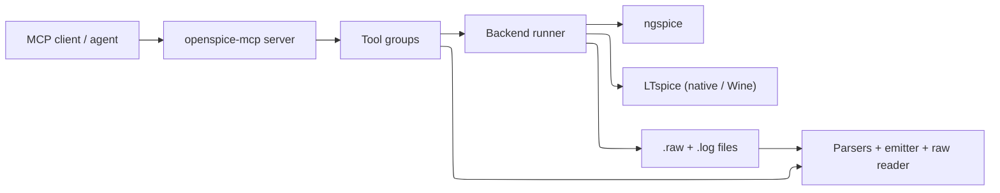
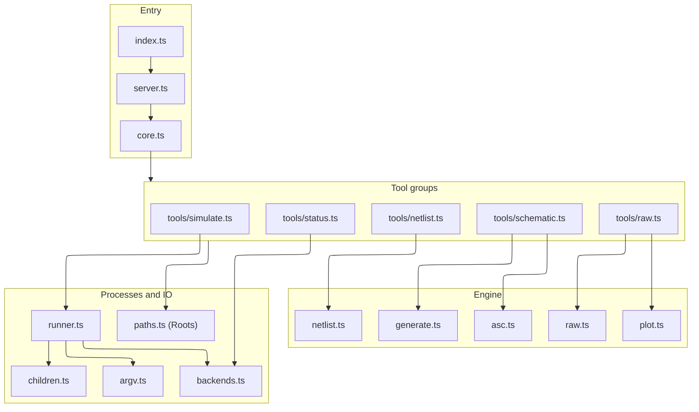
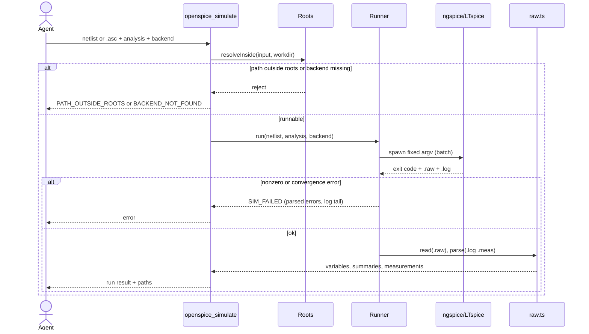
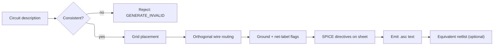
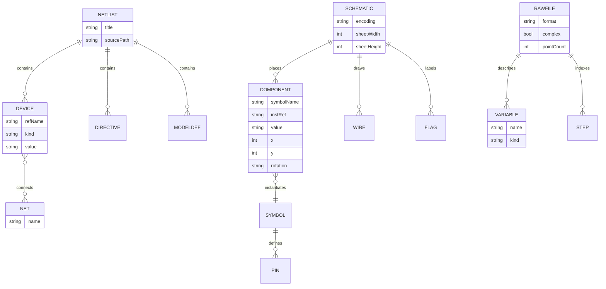
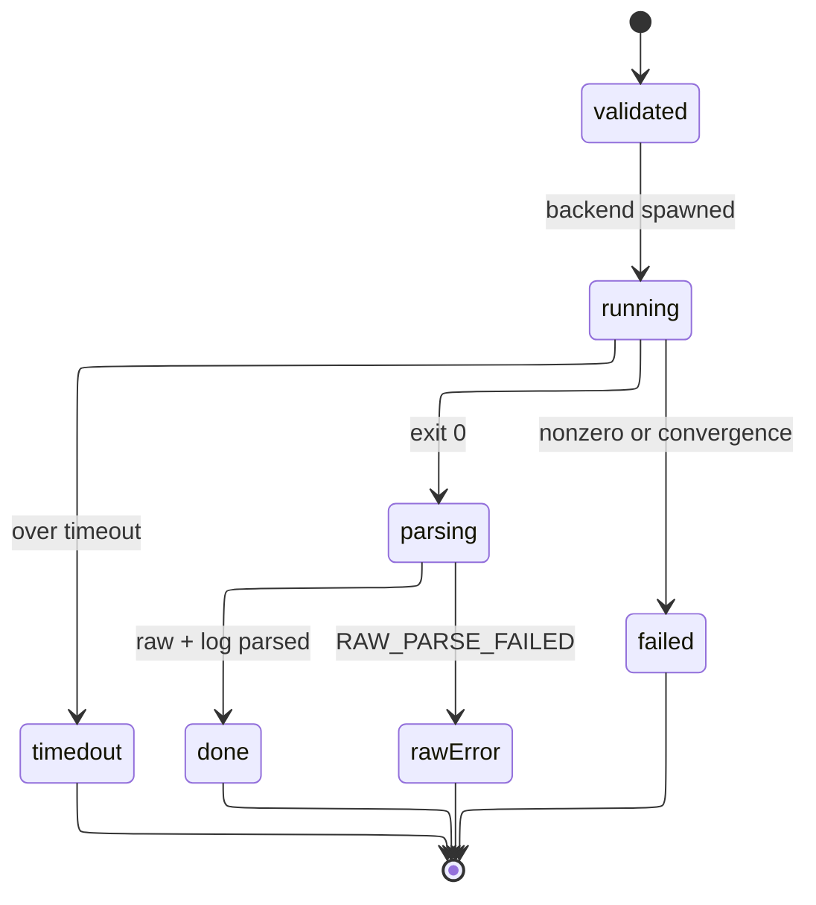
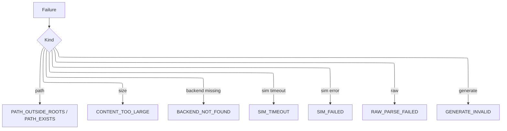

# Design Document

## Overview

OpenSPICE-MCP is an MCP stdio server written in TypeScript (ESM, Node 20+), published as `@sohampatwardhan/openspice-mcp` and run with `npx -y @sohampatwardhan/openspice-mcp@latest`. It gives an agent a fixed, strict set of tools over four capabilities: read/validate SPICE netlists and LTspice `.asc`/`.asy` files, convert `.asc` to a netlist, generate a readable `.asc` from a structured circuit description, run a simulation on LTspice or ngspice, and parse the `.raw` result into measurements, waveform summaries, and an optional plot. The guiding constraint is the same as the sibling `kiro-mcp-server`: no shell escape hatch, fixed argv, every path confined to roots (`realpath`), every child process tracked and killed, strict input schemas with an `outputSchema` on every tool, and `{ "error": { code, message, details } }` on failure.

The server composes a `Core` bundle (`config`, `roots`, `backends`, `children`) that every tool group receives; tools call core modules and parsers, and core modules never import tools. The internal engine is a pure, dependency-light pipeline — a netlist model, an `.asc`/`.asy` model, a `.raw` reader, and an `.asc` emitter — wrapped by a thin backend runner that shells out only to a resolved LTspice or ngspice executable.

Every requirement id is addressed: Requirement 1 by the `backends` probe and `openspice_status`; Requirement 2 by the netlist parser/validator and `openspice_parse_netlist`; Requirement 3 by the `.asc`/`.asy` reader and `openspice_read_schematic`; Requirement 4 by the schematic-to-netlist converter and `openspice_schematic_to_netlist`; Requirement 5 by the `.asc` generator and `openspice_generate_schematic`; Requirement 6 by the backend runner and `openspice_simulate`; Requirement 7 by the `.raw`/`.log` parser, downsampler, optional plotter, and `openspice_read_raw`; Requirement 8 by `Roots`, `argv`, `children`, `config` limits, and shutdown wiring shared by all tools.

### Decisions

| Decision | Why | Rejected |
| --- | --- | --- |
| Mirror `kiro-mcp-server` layout, tsconfig, CI, release, and skills exactly | Owner's established sibling repo; one mental model, proven publish path | A fresh project shape |
| Runtime deps limited to `@modelcontextprotocol/sdk` and `zod`; parsers and `.raw`/`.asc` codecs written in-repo | Matches sibling's lean dependency rule; `.raw`/`.asc` formats are small and stable | Depending on a JS SPICE library |
| Credit spicelib / PyLTSpice (Nuno Brum) for format knowledge; copy no code | Those projects document `.raw` and `.asc` layouts well; license hygiene | Vendoring or porting their code |
| ngspice is the CI backend; LTspice is optional and host-specific | ngspice is open source and installs on Linux CI; LTspice needs Windows/macOS/Wine | Requiring LTspice in CI |
| LTspice on Linux is invoked through Wine; macOS native app noted as weaker in batch | Reflects real LTspice batch support per platform | Claiming uniform LTspice behavior |
| `.asc` generation uses a deterministic grid auto-placer + orthogonal router, not GUI-faithful layout | Requirement 5 asks for readable and openable, not pixel-perfect | A full schematic autorouter |
| Plotting optional, off by default, behind `OPENSPICE_ALLOW_PLOTS`, rendered to a file (SVG) with no heavy chart dep | Keeps default install lean and output text-first; avoids a native canvas dep | Always-on PNG plotting via a binary dep |
| `.raw` sample arrays are downsampled to a `maxPoints` bound; summaries always returned | Transients can hold millions of points; MCP responses must stay small | Returning every raw sample |
| Backend working files live in a per-run temp dir created inside a root | Keeps artifacts confined and cleanable; satisfies Requirement 8.1 | Using the OS temp dir outside roots |
| Backend selection order default `ngspice, ltspice`, overridable per call and by env | ngspice is the portable default; explicit override stays strict | Hard-coding LTspice first |

## Architecture

The process entry (`src/index.ts`) loads config (exit 2 on a config error), opens the stdio transport, registers tool groups, and wires shutdown to stdin close and signals. `src/server.ts` is the composition root that builds `Core` and `SERVER_INSTRUCTIONS`. Tool groups live one-file-per-group under `src/tools/`. The engine modules (`netlist`, `asc`, `raw`, `generate`) are pure and synchronous where possible; only `backends` and `children` touch processes, and only `runner` sequences a simulation. `argv.ts` is the single place a backend command vector is built; `children.ts` is the single module that spawns and signals processes (detached, `shell: false`, tracked, group-killed).

A successful simulation and a rejected one:

## Components and Interfaces

### Roots (`src/paths.ts`)

Resolves every path with `realpath` and rejects anything outside the configured roots before any read, write, or spawn (Requirement 8.1). `resolveInside(path): string` throws `PATH_OUTSIDE_ROOTS`; `ensureWritable(path, overwrite)` throws `PATH_EXISTS`; `makeRunDir(): string` creates a per-run working directory inside the primary root. Must not read or write outside a root. Mirrors the sibling repo's `Roots`.

### Backends (`src/backends.ts`, `src/argv.ts`)

```mermaid
classDiagram
  class Backends {
    +probe() BackendReport[]
    +select(name) Backend
  }
  class Backend {
    +name string
    +path string
    +version string
    +mode string
    +argv(run) string[]
  }
  class Runner {
    +run(input, analysis, backend, timeoutMs) RunResult
  }
  class Children {
    +spawnTracked(exe, argv, cwd) Child
    +stopAll() void
  }
  Runner --> Backends : selects
  Runner --> Children : spawns via
  Backends --> Backend : reports
```

Detects `ngspice` and `ltspice`, reports path, version, and invocation mode (Requirement 1), and selects a backend per call or by the default order. `argv.ts` builds the only command vectors: ngspice batch (`-b -r <raw> -o <log> <deck>`), LTspice native batch (`-b -Run <deck>` writing a sibling `.raw`/`.log`), and LTspice-via-Wine on Linux (the same LTspice argv wrapped by a resolved `wine` executable). No free-form flags; no shell.

### Netlist engine (`src/netlist.ts`)

`parse(text): Netlist` returns title, devices, `.model`/`.subckt` definitions, includes, and directives, collecting per-line diagnostics instead of throwing (Requirement 2.1, 2.4). `validate(netlist): Diagnostic[]` reports floating/singly-connected nodes, duplicate instance names, missing models/subcircuits, and a missing ground node (Requirement 2.5). `emit(netlist): string` serializes back to deck text, used by the converter and generator. Must not run a simulation or touch the filesystem (the tool layer handles IO and include resolution within roots).

### Schematic engine (`src/asc.ts`, `src/generate.ts`)

`asc.ts`: `readAsc(bytes): Schematic` and `readAsy(bytes): Symbol` decode UTF-16/UTF-8(+BOM)/CRLF (Requirement 3.3), model components, wires, flags, and directives, and keep unknown keywords as raw entries (Requirement 3.4). `toNetlist(schematic, symbols): { netlist, warnings }` builds net connectivity from wire endpoints and labels and orders nodes by symbol pin order (Requirement 4). `generate.ts`: `generateAsc(circuit): { asc, warnings } | reject` runs a deterministic grid placer and orthogonal router, places ground on `0`/`GND` nets and net-labels elsewhere, and rejects an inconsistent description (Requirement 5).

### Raw/result engine (`src/raw.ts`, `src/plot.ts`)

`readRaw(bytes): RawFile` sniffs LTspice binary, ngspice binary, and ASCII headers, exposes variables, point count, real/complex flag, and step structure (Requirement 7.1–7.3). `summarize(raw, vars, maxPoints)` returns per-variable summaries plus downsampled arrays (Requirement 7.4). `parseMeas(log): Measurement[]` reads `.meas` results (Requirement 7.5). `plot.ts` `renderPlot(...)` is called only when plotting is enabled and writes an SVG inside a root (Requirement 7.7). A truncated/unknown `.raw` throws `RAW_PARSE_FAILED` (Requirement 7.6).

### Tool groups (`src/tools/*.ts`)

| Tool | Requirement | Purpose |
| --- | --- | --- |
| `openspice_status` | 1 | Backends (path, version, mode), roots, default order, plotting flag, warnings |
| `openspice_parse_netlist` | 2 | Parse + optionally validate a netlist (path or inline) |
| `openspice_read_schematic` | 3 | Read an `.asc` or `.asy` into a structured model |
| `openspice_schematic_to_netlist` | 4 | Convert `.asc` to a netlist; return text or write to roots |
| `openspice_generate_schematic` | 5 | Generate `.asc` (and optional netlist) from a description |
| `openspice_simulate` | 6 | Run a backend on a netlist/`.asc`; return status, paths, diagnostics |
| `openspice_read_raw` | 7 | Parse a `.raw` into variables, summaries, measurements, optional plot |

Every tool has a strict Zod input schema (`additionalProperties: false`), an `outputSchema`, and returns `structuredContent`. Shapes mirror `kiro_status`/`defineTool` in the sibling repo.

## Data Models

A simulation run's lifecycle:

Illegal transitions: `running` never returns `done` without `parsing`; a `failed`/`timedout` run never yields a success result (Requirement 6.6); the run directory is always cleaned and all processes stopped on leaving `running` (Requirement 6.7).

## Error Handling

Failures return `{ error: { code, message, details } }`. New codes join an `ErrorCode` union (mirroring the sibling's `errors.ts`) and the README error table.

| Condition | Code | State afterward |
| --- | --- | --- |
| Path resolves outside roots | `PATH_OUTSIDE_ROOTS` | No IO or process started |
| Write target exists, no overwrite | `PATH_EXISTS` | Existing file unchanged |
| Input too large / inline too long | `CONTENT_TOO_LARGE` | Not parsed |
| Netlist/schematic line unparseable | (diagnostic, not fatal) | Remaining lines parsed |
| `.asc` generation inconsistent | `GENERATE_INVALID` | No file written |
| Requested/any backend missing | `BACKEND_NOT_FOUND` | No process started |
| Simulation over timeout | `SIM_TIMEOUT` | Process group killed, log tail returned |
| Backend nonzero/convergence/syntax | `SIM_FAILED` | No partial success; log + errors returned |
| `.raw` truncated/unknown header | `RAW_PARSE_FAILED` | Parse stop point reported |
| Plot requested while disabled | (diagnostic, not fatal) | Numeric summary still returned |

## Testing Strategy

Tests never require a real LTspice. ngspice is the CI backend; LTspice-specific paths are covered with recorded fixtures and a fake backend executable (a Node script, like the sibling's `fake-kiro.mjs`) selected through `OPENSPICE_*_BIN`, so CI is deterministic and offline.

- Unit: netlist parse/validate (Requirement 2.1, 2.4, 2.5); `.asc`/`.asy` decode across encodings and unknown-keyword retention (3.1–3.4); `.asc`→netlist connectivity and pin order (4.1–4.3); `.asc` generation placement, routing, ground/label flags, and rejection (5.1–5.6); `.raw` format sniffing, complex magnitude/phase, stepped indexing, downsampling, `.meas` parse, and truncation error (7.1–7.6).
- Integration (smoke, server over stdio with the MCP `Client`): exact tool list, strict schemas and `outputSchema`, error shapes, and a full `openspice_simulate` → `openspice_read_raw` loop against ngspice (or the fake backend when ngspice is absent), asserting op/tran/ac paths and that no process is left running (Requirement 6.1, 6.7).
- Property statements:
  - A generated `.asc` round-trips: `readAsc(generateAsc(c))` reproduces the component set and net connectivity of `c`. Validates: Requirement 5.1.
  - `toNetlist` assigns every wired pin to exactly one net; a pin on no net produces a warning, never a silent drop. Validates: Requirement 4.1, 4.3.
  - A `.raw` summary's sample array length never exceeds `maxPoints` while min/max/final match the full data. Validates: Requirement 7.4.
  - Any path outside roots is rejected before IO or spawn. Validates: Requirement 8.1.

## Prior art and credits

Format knowledge for `.raw` (binary/ASCII, real/complex, stepped) and `.asc`/`.asy` draws on the documentation and behavior of [spicelib / PyLTSpice by Nuno Brum](https://github.com/nunobrum/PyLTSpice) and ngspice's manual. No code from those projects is copied or ported; only the publicly documented file layouts inform the in-repo parsers.

## Open questions

1. LTspice batch behavior differs by platform (strong on Windows, weaker via the native macOS app, Linux only through Wine). For the first release, is it acceptable to officially support LTspice simulation on Windows and Linux-via-Wine, and treat the native macOS LTspice batch path as best-effort (parse/convert/generate fully supported, simulation marked experimental)?
2. For plotting, is a dependency-free SVG writer the preferred default, or should the generator emit a gnuplot/ngspice-native plot script instead when a plotting backend is present?
