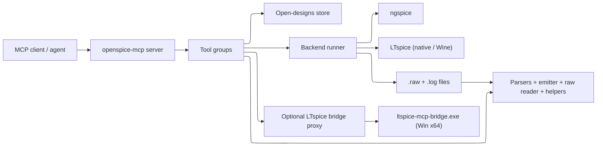
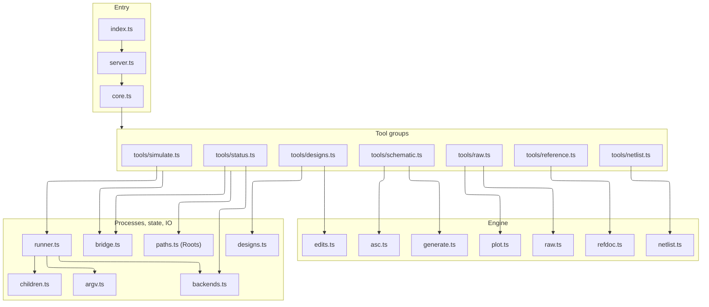
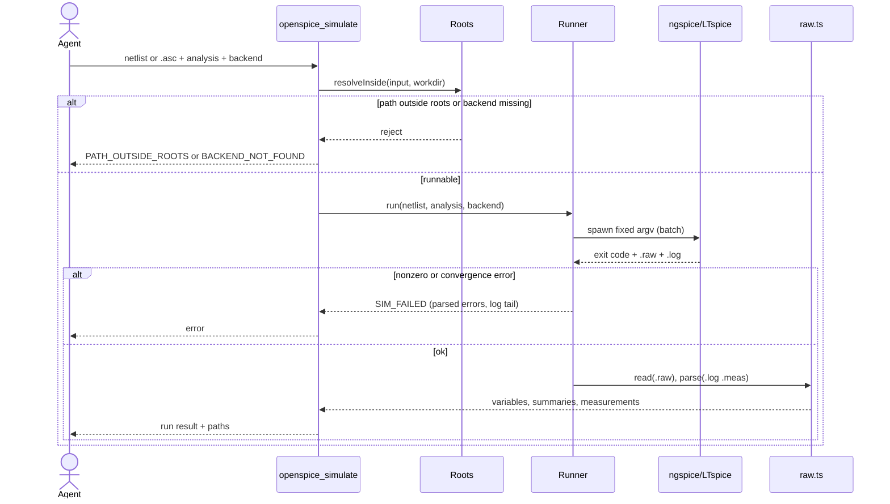
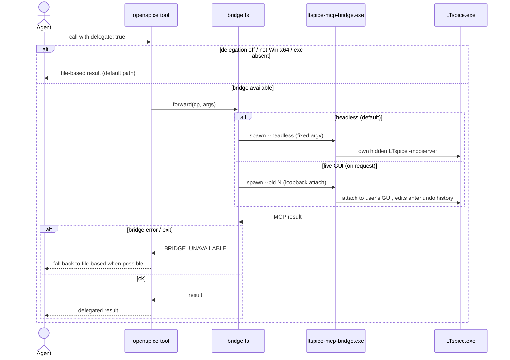
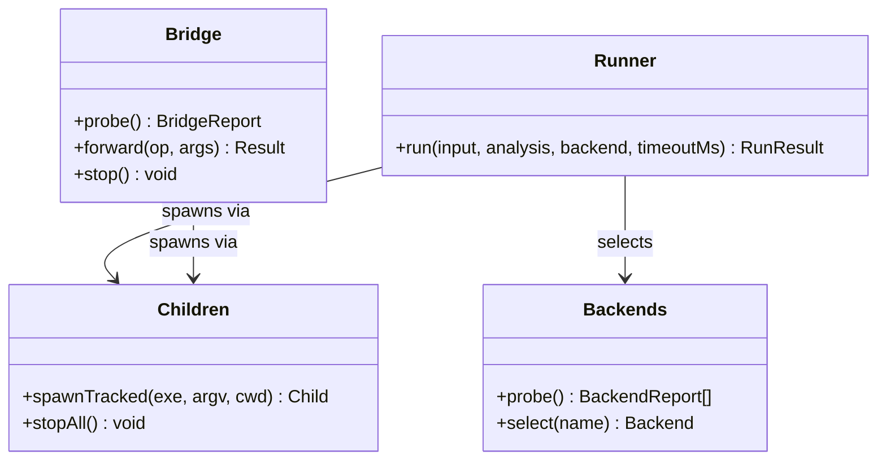
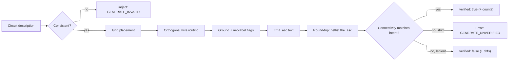
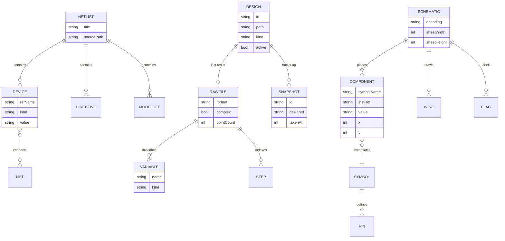
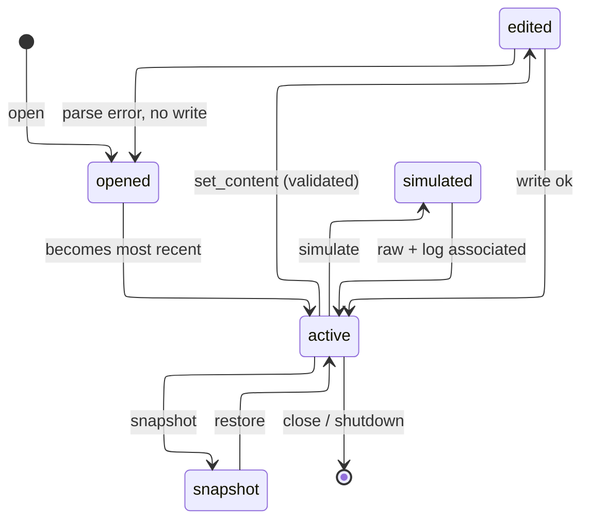
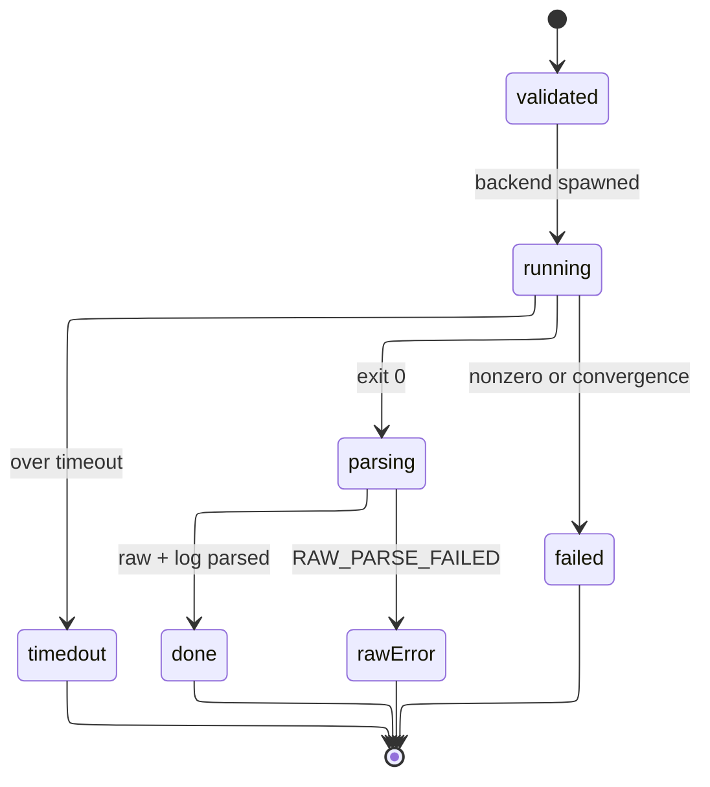
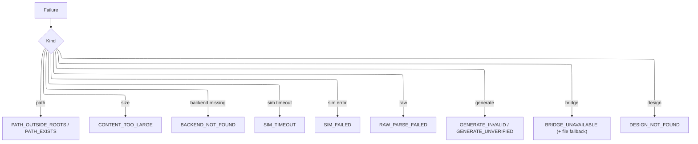

# Design Document

## Overview

OpenSPICE-MCP is an MCP stdio server written in TypeScript (ESM, Node 20+), published as `@sohampatwardhan/openspice-mcp` and run with `npx -y @sohampatwardhan/openspice-mcp@latest`. It gives an agent a fixed, strict set of tools that reach feature parity with Analog Devices' official LTspice MCP server (`ltspice-mcp-bridge.exe`, shipped in LTspice 26.1.1) while working cross-platform and file-based, with no GUI required. Capabilities: read/validate SPICE netlists and LTspice `.asc`/`.asy`; open/list designs and get/set their content as files; convert `.asc` to a netlist; generate a readable `.asc` from a description and verify it by round-trip; run a simulation on LTspice or ngspice; read the SPICE log, `.raw` metadata, waveforms, measurements, and export them; `.meas`/`.step`/parameterize text helpers; list changes since a cursor; and answer LTspice/ngspice how-to questions from locally available docs. On Windows x64 with LTspice ≥ 26.1.1 it can optionally delegate to the official bridge as an MCP client.

The guiding constraint is the same as the sibling `kiro-mcp-server`: no shell escape hatch, fixed argv, every path confined to roots (`realpath`), every child process tracked and killed, strict input schemas with an `outputSchema` on every tool, and `{ "error": { code, message, details } }` on failure. The file-based path is always the default; the bridge is never required.

The server composes a `Core` bundle (`config`, `roots`, `backends`, `children`, `designs`, `bridge`) that every tool group receives; tools call core modules and parsers, and core modules never import tools. The internal engine is a pure, dependency-light pipeline — a netlist model, an `.asc`/`.asy` model, a `.raw` reader, an `.asc` emitter, and text helpers — wrapped by a thin backend runner and an optional MCP-client bridge proxy.

Requirement coverage: R1 `backends`/`bridge` probe + `openspice_status`; R2 netlist parser + `openspice_parse_netlist`; R3 `.asc`/`.asy` reader + `openspice_read_schematic`; R4 converter + `openspice_schematic_to_netlist`; R5 generator + `openspice_generate_schematic`; R6 runner + `openspice_simulate`; R7 `.raw`/`.log` parser + `openspice_read_raw`; R8 `Roots`/`argv`/`children`/limits/shutdown shared by all tools; R9 `designs` store + `openspice_designs` (open/list/active + get/set content + snapshot); R10 `openspice_get_log`, `openspice_raw_info`, `openspice_export_waveforms`; R11 round-trip verifier inside the generator + `openspice_generate_schematic`; R12 text helpers + `openspice_netlist_edit`; R13 `refdoc` indexer + `openspice_reference`; R14 `bridge` proxy + delegation flag on relevant tools.

### Parity with the official LTspice MCP server

Official tool names are taken from `LTspice.json` and strings in `ltspice-mcp-bridge.exe`; exact schemas are not published, so the mapping is by documented capability. The official server drives a live LTspice GUI on Windows x64 only; OpenSPICE's equivalents are file-based and cross-platform, and can delegate to the bridge when present (R14).

| Official LTspice MCP tool / capability | OpenSPICE-MCP equivalent |
| --- | --- |
| `list_open_designs` | `openspice_designs` (op `list`) |
| `open_design` | `openspice_designs` (op `open`) |
| `get_active_design_path` | `openspice_designs` (op `active`) |
| `get_design_content` | `openspice_designs` (op `get_content`) |
| `set_design_content` (edit values, directives, fix syntax) | `openspice_designs` (op `set_content`, with optional snapshot) |
| `get_schematic_netlist` | `openspice_schematic_to_netlist` |
| `get_spice_log` | `openspice_get_log` |
| `get_raw_info` | `openspice_raw_info` |
| `read_raw_waveforms` | `openspice_read_raw` |
| `export_raw_waveforms` | `openspice_export_waveforms` (CSV/ASCII) |
| `list_changed` | `openspice_designs` (op `list_changed`, cursor-based) |
| `get_ref` / `get_ltspice_reference` | `openspice_reference` (op `get`) |
| `list_ltspice_reference_docs` | `openspice_reference` (op `list`) |
| Run a simulation and read the error log | `openspice_simulate` + `openspice_get_log` |
| Add `.meas`, parameterize and `.step` (as text) | `openspice_netlist_edit` (ops `meas`, `step`, `parameterize`) |
| Explain an open schematic / netlist | `openspice_read_schematic` + `openspice_parse_netlist` |
| **Beyond official** — ngspice backend | `openspice_simulate` (`backend: ngspice`) |
| **Beyond official** — macOS, Linux, Windows ARM64 | all tools (file-based); bridge only on Windows x64 |
| **Beyond official** — file-based work without a GUI | `openspice_designs` and every tool operate on files |
| **Beyond official** — `.asc` generation with round-trip verification | `openspice_generate_schematic` (R5, R11) |
| **Beyond official** — in-process `.raw` parsing (binary/ASCII, complex, stepped) | `openspice_read_raw`, `openspice_raw_info` |
| **Beyond official** — `.step`/`.meas` helpers on text | `openspice_netlist_edit` |
| **Beyond official** — optional SVG plots | `openspice_read_raw` (`plot: true`) |

### Decisions

| Decision | Why | Rejected |
| --- | --- | --- |
| Mirror `kiro-mcp-server` layout, tsconfig, CI, release, and skills exactly | Owner's established sibling repo; one mental model, proven publish path | A fresh project shape |
| Runtime deps limited to `@modelcontextprotocol/sdk` and `zod`; parsers/codecs in-repo | Matches sibling's lean dependency rule; formats are small and stable | A JS SPICE library |
| Credit spicelib / PyLTSpice (Nuno Brum) for format knowledge; copy no code | Those projects document `.raw`/`.asc` layouts well; license hygiene | Vendoring or porting their code |
| File-based is the default for every capability; the official bridge is optional and additive | Cross-platform parity; the bridge is Windows-x64 only and not always present | Requiring the bridge for parity |
| Open designs are an in-memory file-based session (id, path, active), not a GUI handle | Gives the official active/open-design concept without a GUI | Depending on a live LTspice instance |
| `set_content` validates then writes; optional snapshot gives undo without a GUI | Matches `set_design_content` safely; file edits are reversible via snapshots | Editing with no safety net |
| `.asc` generation always round-trips (netlist the output, compare connectivity); strict mode fails on mismatch | Directly answers ADI's "AI tools draw schematics badly" caveat; this is the differentiator | Trusting generated geometry blindly |
| Reference tool indexes local `LTspiceHelp` + OpenSPICE docs + ngspice pointers; bundles no ADI docs | Parity on how-to answers without redistributing copyrighted help | Shipping ADI's help files |
| ngspice is the CI backend; LTspice is optional and host-specific | ngspice is open source and installs on Linux CI; LTspice needs Windows/macOS/Wine | Requiring LTspice in CI |
| Bridge runs headless by default; GUI attach (`--pid`/`--port`, loopback) only on explicit request | Headless is deterministic; live-GUI edits land in LTspice undo history when the user wants them | Always attaching to the GUI |
| Plotting optional, off by default (`OPENSPICE_ALLOW_PLOTS`), SVG, no heavy chart dep | Keeps default install lean and output text-first | Always-on PNG via a native dep |
| `.raw` arrays downsampled to a `maxPoints` bound; summaries always returned | Transients hold millions of points; MCP responses must stay small | Returning every raw sample |
| Backend working files live in a per-run temp dir created inside a root | Keeps artifacts confined and cleanable (R8.1) | OS temp dir outside roots |
| Default backend order `ngspice, ltspice`, overridable per call and by env | ngspice is the portable default; explicit override stays strict | Hard-coding LTspice first |

## Architecture

The process entry (`src/index.ts`) loads config (exit 2 on a config error), opens the stdio transport, registers tool groups, and wires shutdown to stdin close and signals. `src/server.ts` is the composition root that builds `Core` and `SERVER_INSTRUCTIONS`. Tool groups live one-file-per-group under `src/tools/`. The engine modules (`netlist`, `asc`, `generate`, `raw`, `plot`, `edits`, `refdoc`) are pure and synchronous where possible. The stateful file-based session lives in `designs.ts`. Only `backends`, `children`, and `bridge` touch processes; only `runner` sequences a simulation. `argv.ts` is the single place a backend or bridge command vector is built; `children.ts` is the single module that spawns and signals processes (detached, `shell: false`, tracked, group-killed).

A successful simulation and a rejected one:

Optional delegation to the official bridge (Windows x64):

## Components and Interfaces

### Roots (`src/paths.ts`)

Resolves every path with `realpath` and rejects anything outside the roots before any read, write, or spawn (R8.1). `resolveInside(path)` throws `PATH_OUTSIDE_ROOTS`; `ensureWritable(path, overwrite)` throws `PATH_EXISTS`; `makeRunDir()` and `snapshotDir()` create working/snapshot directories inside the primary root. Mirrors the sibling repo's `Roots`.

### Backends and bridge (`src/backends.ts`, `src/argv.ts`, `src/bridge.ts`)

`backends.ts` detects `ngspice` and `ltspice`, reports path, version, and invocation mode (R1), and selects a backend. `argv.ts` builds the only command vectors: ngspice batch (`-b -r <raw> -o <log> <deck>`), LTspice native batch (`-b -Run <deck>`), LTspice-via-Wine on Linux (the LTspice argv wrapped by a resolved `wine`), and the bridge (`ltspice-mcp-bridge.exe [--headless | --pid N | --port N] [--ltspice-path P]`). `bridge.ts` detects `ltspice-mcp-bridge.exe` on Windows x64 (R1.5), and when delegation is enabled runs it as an MCP client subprocess, forwarding supported ops and mapping failures to `BRIDGE_UNAVAILABLE` (R14). No free-form flags; no shell.

### Netlist engine and text helpers (`src/netlist.ts`, `src/edits.ts`)

`netlist.ts`: `parse(text)`, `validate(netlist)`, `emit(netlist)` as before (R2). `edits.ts` operates on netlist text for R12: `addMeas(text, spec)`, `addStep(text, param, values)`, `parameterize(text, device, name)`, each returning edited text or a diagnostic when the target is absent, and never running a simulation.

### Schematic engine, generator, and round-trip verifier (`src/asc.ts`, `src/generate.ts`)

`asc.ts`: `readAsc`, `readAsy`, `toNetlist` as before (R3, R4). `generate.ts`: `generateAsc(circuit)` runs placement, routing, and flags (R5), then the round-trip verifier (R11): it calls `toNetlist` on the generated `.asc` and compares the resulting device set and net connectivity with the intended connectivity from the description, returning `verified` plus the compared counts, or `GENERATE_UNVERIFIED` with the differing nets/pins (an error in strict mode).

### Open-designs store (`src/designs.ts`)

Holds the in-memory file-based session (R9, R10 log/raw association, R14 change list). `open(path)` records a design (id, path, kind, active flag); `list()`, `active()`, `getContent(id)`, `setContent(id, text, {snapshot})` (validate → optional snapshot → write), `restore(id)`, and `listChanged(cursor)` which reports designs and result files whose mtime changed since a monotonically increasing cursor. It associates each design with its most recent `.raw`/`.log` for `openspice_get_log` and `openspice_raw_info`.

### Raw/result engine (`src/raw.ts`, `src/plot.ts`)

`readRaw`, `summarize`, `parseMeas` as before (R7); `rawInfo(raw)` returns metadata only (R10.2); `exportWaveforms(raw, vars, path)` writes CSV/ASCII inside a root (R10.3). `plot.renderPlot(...)` writes an SVG when plotting is enabled (R7.7).

### Reference indexer (`src/refdoc.ts`)

`list()` and `get(id)` over three sources tagged by origin: the user's installed `LTspiceHelp` folder when present and inside an allowed location, OpenSPICE's own bundled docs, and ngspice-manual pointers. It reads LTspice help from the user's files only and never ships ADI content (R13).

### Tool groups (`src/tools/*.ts`)

| Tool | Requirement | Purpose |
| --- | --- | --- |
| `openspice_status` | 1, 14 | Backends, bridge availability/path/version, roots, default order, plotting + delegation flags, warnings |
| `openspice_parse_netlist` | 2 | Parse + optionally validate a netlist (path or inline) |
| `openspice_read_schematic` | 3 | Read an `.asc` or `.asy` into a structured model |
| `openspice_schematic_to_netlist` | 4 | Convert `.asc` to a netlist; return text or write to roots |
| `openspice_generate_schematic` | 5, 11 | Generate `.asc` (+ optional netlist) and round-trip verify it |
| `openspice_designs` | 9, 10(assoc), 14 | open / list / active / get_content / set_content / snapshot / restore / list_changed |
| `openspice_netlist_edit` | 12 | `.meas`, `.step`, parameterize helpers on netlist text |
| `openspice_simulate` | 6, 14 | Run a backend (or delegate) on a netlist/`.asc` |
| `openspice_read_raw` | 7 | Parse a `.raw` into variables, summaries, measurements, optional plot |
| `openspice_raw_info` | 10 | `.raw` metadata only |
| `openspice_export_waveforms` | 10 | Export selected variables to CSV/ASCII inside roots |
| `openspice_get_log` | 10 | Return the SPICE log / parsed errors for a design or run |
| `openspice_reference` | 13 | list / get LTspice-help (local), OpenSPICE docs, ngspice pointers |

Tools that have a bridge equivalent (`openspice_designs`, `openspice_schematic_to_netlist`, `openspice_simulate`, `openspice_read_raw`, `openspice_raw_info`, `openspice_export_waveforms`, `openspice_get_log`, `openspice_reference`) accept an optional `delegate` flag; default is the file-based path (R14.3). Every tool has a strict Zod input schema (`additionalProperties: false`), an `outputSchema`, and returns `structuredContent`.

## Data Models

A design's lifecycle in the file-based session:

A simulation run's lifecycle:

Illegal transitions: `set_content` never writes on a parse error (R9.6); `running` never returns `done` without `parsing`; a `failed`/`timedout` run never yields a success result (R6.6); the run directory is always cleaned and all processes stopped on leaving `running` (R6.7).

## Error Handling

Failures return `{ error: { code, message, details } }`. New codes join an `ErrorCode` union (mirroring the sibling's `errors.ts`) and the README error table.

| Condition | Code | State afterward |
| --- | --- | --- |
| Path resolves outside roots | `PATH_OUTSIDE_ROOTS` | No IO or process started |
| Write target exists, no overwrite | `PATH_EXISTS` | Existing file unchanged |
| Input too large / inline too long | `CONTENT_TOO_LARGE` | Not parsed |
| Netlist/schematic line unparseable | (diagnostic, not fatal) | Remaining lines parsed |
| `set_content` parse error | (diagnostic, not fatal) | File not written (R9.6) |
| `.asc` generation inconsistent | `GENERATE_INVALID` | No file written |
| `.asc` round-trip mismatch (strict) | `GENERATE_UNVERIFIED` | Not presented as verified; no write in strict mode |
| Netlist-edit target absent | (diagnostic, not fatal) | Text unaltered (R12.4) |
| Requested/any backend missing | `BACKEND_NOT_FOUND` | No process started |
| Simulation over timeout | `SIM_TIMEOUT` | Process group killed, log tail returned |
| Backend nonzero/convergence/syntax | `SIM_FAILED` | No partial success; log + errors returned |
| `.raw` truncated/unknown header | `RAW_PARSE_FAILED` | Parse stop point reported |
| No result/log for a design | (diagnostic, not fatal) | No fabricated data (R10.4) |
| Bridge disabled/absent/exited/failed | `BRIDGE_UNAVAILABLE` | File-based fallback when available (R14.4) |
| Design id unknown | `DESIGN_NOT_FOUND` | No change |
| Plot requested while disabled | (diagnostic, not fatal) | Numeric summary still returned |

## Testing Strategy

Tests never require a real LTspice or the real bridge. ngspice is the CI backend; LTspice-specific and bridge paths are covered with recorded fixtures and fake executables (Node scripts, like the sibling's `fake-kiro.mjs`) selected through `OPENSPICE_*_BIN` and `OPENSPICE_BRIDGE_BIN`, so CI is deterministic and offline.

- Unit: netlist parse/validate (R2); `.asc`/`.asy` decode and unknown-keyword retention (R3); `.asc`→netlist connectivity and pin order (R4); generation placement/routing/flags/rejection and the round-trip verifier (R5, R11); `.raw` sniffing, complex magnitude/phase, stepped indexing, downsampling, `.meas` parse, truncation, `rawInfo`, and CSV export (R7, R10); text helpers for `.meas`/`.step`/parameterize including absent-target diagnostics (R12); open-designs get/set/snapshot/restore/list_changed and parse-error-no-write (R9); reference indexer source tagging and local-only LTspice help (R13).
- Integration (smoke, server over stdio with the MCP `Client`): exact tool list, strict schemas and `outputSchema`, error shapes; a full `openspice_designs open` → `set_content` → `openspice_simulate` → `openspice_get_log` → `openspice_read_raw`/`openspice_export_waveforms` loop against ngspice (or the fake backend), asserting no process is left running (R6.7); delegation routed to a fake bridge binary and the `BRIDGE_UNAVAILABLE` fallback (R14).
- Property statements:
  - A generated `.asc` round-trips: netlisting `generateAsc(c)` reproduces the device set and net connectivity of `c`, or the tool reports `verified: false`/errors — never a silent pass. Validates: Requirement 11.1, 11.3.
  - `toNetlist` assigns every wired pin to exactly one net; a pin on no net produces a warning, never a silent drop. Validates: Requirement 4.1, 4.3.
  - `set_content` with invalid text leaves the file byte-for-byte unchanged. Validates: Requirement 9.6.
  - A `.raw` summary's sample array length never exceeds `maxPoints` while min/max/final match the full data. Validates: Requirement 7.4.
  - Any path outside roots is rejected before IO or spawn. Validates: Requirement 8.1.
  - Reference `get` never returns ADI help text from the package; LTspice-help content comes only from the user's installed files. Validates: Requirement 13.2, 13.4.

## Platform notes

- The official LTspice MCP server is in the **Windows x64** build only (LTspice 26.1.1, 2026-09-02; a later release added MCP enhancements). `ltspice-mcp-bridge.exe` ships next to `LTspice.exe`; with no flag it attaches to the newest live GUI instance, else starts idle and launches a hidden `LTspice.exe -mcpserver` on first need. Flags used by OpenSPICE's optional proxy: `--headless`, `--pid N`, `--port N` (loopback only), `--ltspice-path P` (or `LTSPICE_INSTALL_DIR`), `--list`. Edits to open designs enter LTspice's undo history and are visible live.
- The native **Windows ARM64** build (`LTspice64_arm.msi`) and the **macOS** build (`LTspice_26.pkg`, macOS 10.15+, so current macOS such as macOS 27 installs it) are still **26.0.2 with no MCP**. The x64 MSI refuses to install on Windows ARM64 (LaunchConditions), and the extracted x64 exe does not start under emulation there. So OpenSPICE treats bridge delegation as **Windows x64 only** and reports it unavailable elsewhere (R1.5, R14).
- LTspice **batch** simulation is strong on Windows, available on Linux through **Wine**, and **best-effort via the native macOS app** (weaker batch support). macOS 27 is fine for the macOS LTspice pkg and for ngspice; no special handling beyond marking macOS LTspice batch best-effort. ngspice is the portable, fully supported backend everywhere and is the CI backend.

## Prior art and credits

Format knowledge for `.raw` (binary/ASCII, real/complex, stepped) and `.asc`/`.asy` draws on the documentation and behavior of [spicelib / PyLTSpice by Nuno Brum](https://github.com/nunobrum/PyLTSpice) and ngspice's manual. Parity targets Analog Devices' official LTspice MCP server (LTspice 26.1.1, `ltspice-mcp-bridge.exe`, and the `Third_Party_AI_Tools` help page). No code from those projects is copied or ported, and no ADI documentation is bundled; only publicly documented file layouts and tool/capability names inform OpenSPICE's in-repo implementation.

## Open questions

1. The official MCP bridge is Windows-x64 only and LTspice batch on the native macOS app is weaker than on Windows. Is it acceptable to ship with LTspice simulation officially supported on Windows (batch and, when present, bridge) and Linux-via-Wine, LTspice on macOS marked best-effort (parse/convert/generate/ngspice fully supported there), and bridge delegation offered only on Windows x64?
2. For the optional bridge, should the default be `--headless` (own a hidden LTspice instance, fully deterministic) with live-GUI attach (`--pid`/`--port`) only when the caller explicitly asks for edits in the user's open window, or should OpenSPICE prefer attaching to an already-open GUI when one exists?
