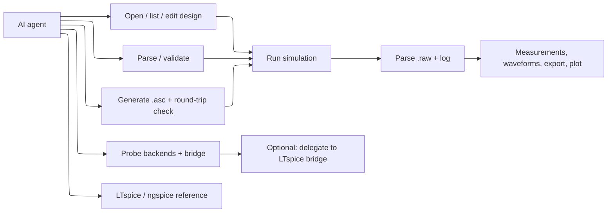

# Requirements Document

## Introduction

OpenSPICE-MCP is an MCP stdio server that lets an AI agent work with SPICE circuits through typed tools instead of shell commands. It parses and validates SPICE netlists (`.cir`, `.net`, `.sp`) and LTspice schematic and symbol files (`.asc`, `.asy`), converts a schematic to a netlist, generates readable LTspice `.asc` schematics from a structured circuit description, runs simulations with LTspice or ngspice, and parses the resulting `.raw` waveform files (binary and ASCII, real and complex, stepped) into measurements, waveform summaries, and optional plots. It is the SPICE sibling of the owner's `kiro-mcp-server` and follows that repo's layout, tooling, CI, release, and safety conventions.

It targets feature parity with Analog Devices' official LTspice MCP server (shipped in LTspice 26.1.1 via `ltspice-mcp-bridge.exe`) while working cross-platform and without a GUI. The official server is Windows-x64 only and drives a live LTspice instance; OpenSPICE-MCP delivers the same capabilities — read/edit design content, netlist a schematic, run and read a simulation, read the SPICE log, read/export waveform data, list changes, and answer LTspice how-to questions — against files on any platform, and can optionally delegate to the official bridge when it is present. The design's parity table maps each official tool to its OpenSPICE-MCP equivalent and marks what is beyond the official server. ADI documents that AI tools are weak at drawing schematics and recommends limiting AI edits to text; OpenSPICE-MCP's differentiator is a deterministic `.asc` generator with a connectivity round-trip check (Requirement 5, 11).

Scope calls made for this spec (rationale in `design.md`): the server exposes a fixed, strict tool set with no shell escape hatch; it shells out only to detected LTspice or ngspice backends (and, optionally, the official bridge as an MCP subprocess), never to arbitrary commands; all file access is confined to configured roots; `.asc` generation targets readable auto-placement for small-to-medium circuits with round-trip verification, not pixel-perfect reproduction of hand-drawn sheets; plotting is optional and off by default. The LTspice reference tool indexes the user's locally installed `LTspiceHelp` folder and OpenSPICE's own docs rather than bundling ADI's copyrighted help. Out of scope for this release: GUI schematic editing, Monte Carlo and worst-case orchestration beyond passing through `.step`, waveform math expressions beyond the measurements the backend reports, and shipping any ADI documentation.

## Requirements

### Requirement 1

**User Story:** As an agent, I want to probe the host for SPICE backends and the optional LTspice bridge, so that I know which simulators, delegation paths, and file operations are available before I call other tools.

#### Acceptance Criteria

1. WHEN the probe tool is called THEN the system SHALL report, for each known backend (`ltspice`, `ngspice`), whether it is installed, its resolved executable path, its reported version when obtainable, and the invocation mode it will use (native `-b` batch, or Wine-wrapped on Linux).
2. WHEN LTspice is found on a non-Windows host THEN the system SHALL report the platform-specific launch method (native macOS app or Linux-via-Wine) and any reduced-capability warning for that method.
3. WHEN no backend is installed THEN the system SHALL return an empty backend list with a human-readable install hint per backend and SHALL NOT fail the call.
4. WHEN the probe tool is called THEN the system SHALL report the configured roots, the default backend selection order, whether plotting is enabled, and whether the optional LTspice-bridge delegation is enabled.
5. WHEN the host is Windows x64 THEN the system SHALL report whether `ltspice-mcp-bridge.exe` is present, its resolved path, and its version when obtainable; WHERE the host is Windows ARM64, macOS, or Linux the system SHALL report the bridge as unavailable with a one-line reason.

### Requirement 2

**User Story:** As an agent, I want to parse and validate a SPICE netlist, so that I can inspect its devices, nets, and analyses and catch errors before simulating.

#### Acceptance Criteria

1. WHEN a path to a `.cir`, `.net`, or `.sp` file inside the roots is given THEN the system SHALL return a structured netlist: the title line, every device (type, instance name, connected nodes, value or model, parameters), subcircuit definitions, model statements, included files, and analysis/control directives (`.op`, `.tran`, `.ac`, `.dc`, `.noise`, `.step`, `.meas`, `.param`).
2. WHEN netlist text is supplied inline instead of a path THEN the system SHALL parse it with the same result shape.
3. IF the netlist references a `.include` or `.lib` path THEN the system SHALL resolve it relative to the netlist's directory, confine it to the roots, and record each resolved and unresolved reference without reading files outside the roots.
4. IF a line cannot be parsed THEN the system SHALL return a diagnostic with the 1-based line number, the offending text, and a reason, and SHALL continue parsing the remaining lines.
5. WHEN validation is requested THEN the system SHALL report floating nodes, nodes connected to a single device, duplicate instance names, missing models or subcircuits, and the absence of a ground (`0`) node as warnings or errors without modifying the file.

### Requirement 3

**User Story:** As an agent, I want to read an LTspice schematic or symbol file, so that I can understand a captured design without opening LTspice.

#### Acceptance Criteria

1. WHEN a path to an `.asc` file inside the roots is given THEN the system SHALL return the sheet's components (symbol name, instance reference, value, grid coordinates, rotation/mirror), wires (endpoint coordinates), net labels/flags, and directive text (`.tran`, `.ac`, SPICE directives placed on the sheet).
2. WHEN a path to an `.asy` symbol file is given THEN the system SHALL return the symbol's pins (name, order, coordinates), drawing primitives, and attributes.
3. IF the file is UTF-16 or UTF-8 with a BOM, or uses CRLF line endings THEN the system SHALL decode it correctly and report the detected encoding.
4. IF a line uses an `.asc` keyword the parser does not model THEN the system SHALL preserve it as a raw directive entry rather than dropping it, and SHALL record a diagnostic naming the keyword.

### Requirement 4

**User Story:** As an agent, I want to convert an LTspice schematic into a SPICE netlist, so that I can simulate a captured design with any backend.

#### Acceptance Criteria

1. WHEN an `.asc` file is given THEN the system SHALL resolve each component's pins to nets derived from wire connectivity and net labels, and SHALL emit a SPICE netlist whose devices, nodes, values, and on-sheet directives match the schematic.
2. WHEN a component references an `.asy` symbol with a defined pin order THEN the system SHALL order the netlist node list to match that pin order.
3. IF two placed components or wires imply a short or an unconnected pin THEN the system SHALL emit the netlist and attach a connectivity warning naming the component and pin.
4. WHEN requested THEN the system SHALL write the netlist to a `.cir`/`.net` path inside the roots, refusing to overwrite an existing file unless overwrite is set, and otherwise SHALL return the netlist text only.

### Requirement 5

**User Story:** As an agent, I want to generate an LTspice `.asc` schematic from a structured circuit description, so that I can hand a user an editable, readable schematic rather than only a netlist.

#### Acceptance Criteria

1. WHEN a circuit description of components (type, reference, value, symbol) and connections (named nets joining component pins) is given THEN the system SHALL produce a valid `.asc` file that LTspice can open, with components placed on the LTspice grid and wires routed orthogonally between their pins.
2. WHEN placing components THEN the system SHALL assign grid coordinates so that components do not overlap and labels remain legible, and SHALL place a ground flag on every net named `0` or `GND`.
3. WHEN routing wires THEN the system SHALL connect every pin that shares a net and SHALL add a net-label flag for each named net other than ground.
4. IF the description includes analysis directives THEN the system SHALL place them as a SPICE directive on the sheet.
5. IF the description is inconsistent (an unknown symbol, a pin referenced on no net, or a net joining fewer than two pins) THEN the system SHALL reject the request with a diagnostic identifying the offending element and SHALL NOT write a file.
6. WHEN requested THEN the system SHALL write the `.asc` to a path inside the roots, refusing to overwrite unless overwrite is set, and SHALL be able to emit the equivalent netlist for the same description.

### Requirement 6

**User Story:** As an agent, I want to run a simulation on a netlist or schematic, so that I can get results without driving a simulator by hand.

#### Acceptance Criteria

1. WHEN a netlist path, inline netlist, or `.asc` path and an analysis (`op`, `tran`, `ac`, `dc`, `noise`, or "use directives in the file") is given THEN the system SHALL run it on the selected or default backend in batch mode and SHALL return the run status, the backend used, the produced `.raw` and log paths inside a working directory within the roots, and any solver diagnostics.
2. WHEN the input is an `.asc` file THEN the system SHALL convert it to a netlist first (Requirement 4) and simulate the netlist.
3. WHEN the netlist contains `.step` or `.meas` directives THEN the system SHALL preserve them so the backend produces stepped data and measurement output.
4. IF no backend is available, or the requested backend is not installed THEN the system SHALL return a `BACKEND_NOT_FOUND` error naming the missing backend and the install hint, without starting a process.
5. IF the simulation exceeds the configured timeout THEN the system SHALL stop the backend process group and return a `SIM_TIMEOUT` error with the captured log tail.
6. IF the backend exits nonzero or reports a convergence or syntax failure THEN the system SHALL return a `SIM_FAILED` error carrying the parsed error lines and the log tail, and SHALL NOT return partial results as success.
7. WHEN a simulation completes THEN every process it started SHALL be terminated, and the server SHALL leave no backend process running.

### Requirement 7

**User Story:** As an agent, I want parsed simulation results, so that I can report measurements and waveform behavior without handling binary files.

#### Acceptance Criteria

1. WHEN a `.raw` file produced by a run (or given by path inside the roots) is read THEN the system SHALL detect its format (LTspice binary, ngspice binary, or ASCII) and report the variable list (name, unit/kind), the number of points, and whether the data is real or complex.
2. WHEN the data is complex (an `.ac` run) THEN the system SHALL return magnitude and phase alongside the real and imaginary parts for requested variables.
3. WHEN the run was stepped (`.step`) THEN the system SHALL report the step count and the parameter values per step, and SHALL key returned waveforms by step index.
4. WHEN waveform data is requested THEN the system SHALL return a summary per variable (min, max, final value, and for time-domain data an approximate peak-to-peak and mean) and SHALL return downsampled sample arrays bounded by a configured maximum point count rather than every raw point.
5. WHEN the netlist contained `.meas` directives THEN the system SHALL parse the measurement results from the log and return them as name/value pairs.
6. IF the `.raw` file is truncated or its header is unrecognized THEN the system SHALL return a `RAW_PARSE_FAILED` error identifying where parsing stopped.
7. WHEN a plot is requested AND plotting is enabled THEN the system SHALL render the selected variables to an image file inside the roots and return its path; WHERE plotting is disabled the system SHALL return a diagnostic that plotting is off and SHALL still return the numeric summary.

### Requirement 8

**User Story:** As an operator, I want file and process access confined and the tool surface fixed, so that an agent driving the server cannot reach outside the project or run arbitrary commands.

#### Acceptance Criteria

1. IF any input or output path resolves (via `realpath`) outside the configured roots THEN the system SHALL reject the call with `PATH_OUTSIDE_ROOTS` before any file read, file write, or process start.
2. WHEN a backend or the optional LTspice bridge is launched THEN the system SHALL spawn only a resolved LTspice, ngspice, Wine, or `ltspice-mcp-bridge.exe` executable with a fixed argument vector built in one module, with no shell and no caller-supplied free-form flags.
3. IF a requested write target exists and overwrite is not set THEN the system SHALL return `PATH_EXISTS` and SHALL NOT modify the existing file.
4. IF an input file exceeds the configured size limit, or an inline netlist exceeds its length limit THEN the system SHALL return `CONTENT_TOO_LARGE` without parsing it.
5. WHEN the server shuts down (stdin close, SIGINT, SIGTERM, or SIGHUP) THEN the system SHALL terminate every tracked backend and bridge process group and exit.

### Requirement 9

**User Story:** As an agent, I want a file-based "open designs" concept with get/set content, so that I have the same working-set and edit capability as the official server's active/open design tools, without a GUI.

#### Acceptance Criteria

1. WHEN a design (an `.asc` or netlist path inside the roots) is opened THEN the system SHALL record it in an in-memory open-designs set with a stable id and SHALL mark the most recently opened or acted-on design as the active design.
2. WHEN the open-designs list is requested THEN the system SHALL return each open design's id, path, kind (`schematic` or `netlist`), and whether it is active, and WHEN the active design path is requested THEN the system SHALL return it or report that none is active.
3. WHEN the content of a design is requested THEN the system SHALL return its current text (the `.asc` text or the netlist text) and its detected encoding.
4. WHEN new content is set for a design THEN the system SHALL validate it (schematic parse or netlist parse) before writing, SHALL write it back to the design's path inside the roots, and SHALL make the written text readable on the next get.
5. IF a backup or undo snapshot is requested on a set THEN the system SHALL save the prior content as a snapshot inside the roots and SHALL be able to restore the most recent snapshot for that design.
6. IF setting content produces a parse error THEN the system SHALL return a diagnostic and SHALL NOT overwrite the existing file.

### Requirement 10

**User Story:** As an agent, I want to retrieve the SPICE log, raw metadata, and exportable waveform data for a design or run, so that I can report errors and numbers the way the official server does.

#### Acceptance Criteria

1. WHEN the SPICE log for a design or a completed run is requested THEN the system SHALL return the log text (or its parsed error/warning lines) from the log produced for that design's most recent simulation, or report that no log exists yet.
2. WHEN raw info for a design or run is requested THEN the system SHALL return the `.raw` metadata (format, variable list, point count, real/complex, step structure) without returning full sample arrays.
3. WHEN waveform export is requested THEN the system SHALL write the selected variables to a CSV (or ASCII) file inside the roots and return its path, and SHALL refuse to overwrite an existing target unless overwrite is set.
4. IF no `.raw` result exists for the design THEN the system SHALL return a diagnostic naming the design and SHALL NOT fabricate data.

### Requirement 11

**User Story:** As an agent, I want the generated schematic verified by round-trip against the intended connectivity, so that an AI-produced `.asc` is trustworthy despite ADI's warning that AI tools draw schematics poorly.

#### Acceptance Criteria

1. WHEN an `.asc` is generated from a description THEN the system SHALL netlist the generated `.asc` (Requirement 4) and compare its device set and net connectivity against the intended connectivity derived from the description.
2. IF the round-trip netlist matches the intended connectivity THEN the system SHALL return the `.asc` with a `verified: true` result and the compared net/device counts.
3. IF the round-trip netlist does not match THEN the system SHALL return a `GENERATE_UNVERIFIED` result listing each differing net or pin and SHALL NOT present the schematic as verified, and WHERE strict mode is set the system SHALL treat the mismatch as an error and not write the file.

### Requirement 12

**User Story:** As an agent, I want to apply `.meas` and `.step` helpers and parameterize values on netlist text, so that I can set up measurements and sweeps the way the official server does, as text edits.

#### Acceptance Criteria

1. WHEN a `.meas` helper is applied with a measurement specification THEN the system SHALL insert or update the corresponding `.meas` directive in the netlist text and SHALL return the edited text without running a simulation.
2. WHEN a `.step` helper is applied for a named parameter and value set THEN the system SHALL insert or update the `.param` and `.step` directives so the sweep is defined, and SHALL return the edited text.
3. WHEN a value is parameterized THEN the system SHALL replace the literal device value with a `{name}` reference and add a `.param name=<value>` directive, preserving the original value as the default.
4. IF a helper targets a device, parameter, or directive that is not present THEN the system SHALL return a diagnostic identifying it and SHALL NOT alter the text.

### Requirement 13

**User Story:** As an agent, I want an LTspice/ngspice reference lookup that uses locally available docs, so that I can answer how-to questions without OpenSPICE bundling ADI's copyrighted help.

#### Acceptance Criteria

1. WHEN reference docs are listed THEN the system SHALL return the entries it can index: the user's local `LTspiceHelp` folder when it is installed and inside an allowed location, OpenSPICE's own bundled docs, and pointers to the ngspice manual, each tagged with its source.
2. WHEN a reference entry is fetched THEN the system SHALL return the text of an OpenSPICE-owned doc directly, and for a local `LTspiceHelp` entry SHALL return content read from the user's installed file rather than any copy shipped with OpenSPICE.
3. WHERE the `LTspiceHelp` folder is not installed or not inside an allowed location THEN the system SHALL omit those entries and SHALL still return OpenSPICE docs and the ngspice pointers.
4. THE system SHALL NOT bundle, redistribute, or embed Analog Devices' LTspice documentation in the package.

### Requirement 14

**User Story:** As an agent on Windows x64 with a recent LTspice, I want OpenSPICE to optionally delegate to the official LTspice MCP bridge, so that I can drive a live LTspice instance and have edits land in LTspice's undo history.

#### Acceptance Criteria

1. WHERE delegation is enabled AND the host is Windows x64 AND `ltspice-mcp-bridge.exe` (LTspice 26.1.1 or later) is present THEN the system SHALL start the bridge as an MCP client subprocess and expose its availability through the status tool.
2. WHEN delegation is requested for a supported operation (read/edit open design content, netlist, simulate, read log, read/export waveforms, list changes, reference lookup) THEN the system SHALL forward the call to the bridge and return its result, preferring headless mode by default and attaching to the user's open GUI instance (`--pid`/`--port`, loopback only) only when the caller asks for live-GUI edits.
3. IF delegation is disabled, unavailable, or the host is not Windows x64 THEN the system SHALL use the file-based path and SHALL NOT require the bridge; the file-based path SHALL remain the default for every operation.
4. IF the bridge process exits or fails a forwarded call THEN the system SHALL return a `BRIDGE_UNAVAILABLE` error and SHALL fall back to the file-based path when the operation has a file-based equivalent.
