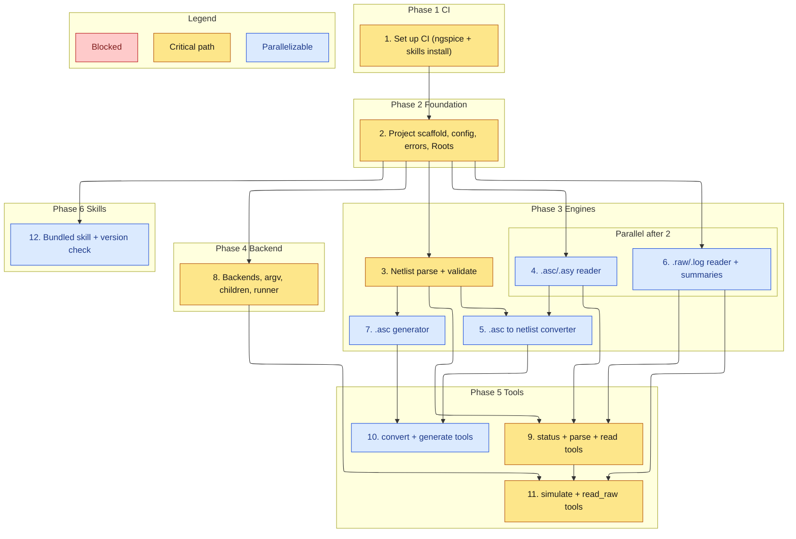

# Implementation Plan

Builds the OpenSPICE-MCP server bottom-up: shared safety core, then the four engines (netlist, schematic, raw), then the backend runner, then the MCP tool surface, then the bundled skill and its CI install check.

## Task graph

An arrow means depends-on. Primary critical path: 1, 2, 3, 8, 9, 11. CI (task 1) runs first and gates everything.

The critical path is the chain that delivers a working simulate-and-read loop: CI, foundation, the netlist model, the backend runner, the base tools, and the simulate/read_raw tools.

## Tasks

- [ ] 1. Set up CI for build and test
  - Create `.github/workflows/ci.yml` (sibling-style): a `test` job on Node 22 running `npm ci`, `npm run build` (strict `tsc`), and `npm test`, plus a step that installs ngspice on the runner so the simulate smoke test runs against a real backend
  - Add a `skills` job that runs `node scripts/check-skill-versions.mjs skills` and installs the bundled skills into a throwaway `HOME` via `npx -y skills add "$GITHUB_WORKSPACE" -g -y`, asserting each skill reports `installed`
  - Keep a `release.yml` matching the sibling (tag `vX.Y.Z` gate, npm trusted publishing with provenance, GitHub release, GitHub Packages mirror)
  - Gates every later task: it must pass before task 2 starts

- [ ] 2. Scaffold the project and the safety core
  - Add `package.json` (`@sohampatwardhan/openspice-mcp`, bin `openspice-mcp`, deps `@modelcontextprotocol/sdk` + `zod` only), `tsconfig.json`, `AGENTS.md`, and `CLAUDE.md` mirroring the sibling repo
  - Implement `src/config.ts` (env vars `OPENSPICE_ROOTS`, `OPENSPICE_LTSPICE_BIN`, `OPENSPICE_NGSPICE_BIN`, `OPENSPICE_WINE_BIN`, `OPENSPICE_ALLOW_PLOTS`, `OPENSPICE_BACKEND_ORDER`, timeouts, `LIMITS`), `src/errors.ts` (`ErrorCode` union, `ToolError`, `okResult`/`toolErrorResult`), and `src/paths.ts` (`Roots` with `realpath`, `resolveInside`, `ensureWritable`, `makeRunDir`)
  - _Requirements: 8.1, 8.3, 8.4_

- [ ] 3. Implement the netlist parser and validator
  - `src/netlist.ts`: `parse(text)` building the title, devices, `.model`/`.subckt`, includes, and directives with per-line diagnostics; `validate(netlist)` for floating/singly-connected nodes, duplicate instances, missing models/subcircuits, and missing ground; `emit(netlist)` back to deck text
  - Resolve `.include`/`.lib` targets relative to the source dir and confine them to roots at the tool layer
  - _Requirements: 2.1, 2.2, 2.3, 2.4, 2.5_

- [ ] 4. Implement the .asc/.asy reader
  - `src/asc.ts`: `readAsc(bytes)` and `readAsy(bytes)` with UTF-16/UTF-8(+BOM)/CRLF decoding and detected-encoding reporting; model components, wires, flags, directives; retain unknown keywords as raw entries with a diagnostic
  - _Requirements: 3.1, 3.2, 3.3, 3.4_

- [ ] 5. Implement the schematic-to-netlist converter
  - In `src/asc.ts`: `toNetlist(schematic, symbols)` deriving nets from wire endpoints and labels, ordering nodes by symbol pin order, and emitting warnings for shorts/unconnected pins; reuse `netlist.emit`
  - _Requirements: 4.1, 4.2, 4.3, 4.4_

- [ ] 6. Implement the .raw and .log reader
  - `src/raw.ts`: `readRaw(bytes)` sniffing LTspice binary, ngspice binary, and ASCII; expose variables, point count, real/complex, and step structure; `summarize(raw, vars, maxPoints)` for per-variable summaries and bounded downsampled arrays; complex magnitude/phase; `parseMeas(log)`; `RAW_PARSE_FAILED` on truncation/unknown header
  - _Requirements: 7.1, 7.2, 7.3, 7.4, 7.5, 7.6_

- [ ] 7. Implement the .asc generator
  - `src/generate.ts`: `generateAsc(circuit)` with deterministic grid placement, orthogonal wire routing, ground flags on `0`/`GND`, net-label flags elsewhere, on-sheet directive placement, `GENERATE_INVALID` rejection, and an equivalent-netlist emit path
  - _Requirements: 5.1, 5.2, 5.3, 5.4, 5.5, 5.6_

- [ ] 8. Implement backends, fixed argv, child tracking, and the runner
  - `src/backends.ts` (probe/select ngspice + LTspice with path, version, mode), `src/argv.ts` (ngspice `-b`, LTspice `-b -Run`, Linux Wine wrap; no shell, no free-form flags), `src/children.ts` (detached, tracked, `stopAll`), `src/runner.ts` (prepare run dir, spawn, enforce timeout, classify exit into success/`SIM_FAILED`/`SIM_TIMEOUT`, clean up and stop processes)
  - Add a fake backend fixture (`test/fixtures/fake-backend.mjs`) selected via `OPENSPICE_*_BIN` so tests never need a real simulator
  - _Requirements: 6.4, 6.5, 6.6, 6.7, 8.2, 8.5_

- [ ] 9. Add the status, parse-netlist, and read-schematic tools
  - `src/tools/status.ts` (`openspice_status`: backends, roots, default order, plotting flag, warnings), `src/tools/netlist.ts` (`openspice_parse_netlist`), `src/tools/schematic.ts` (`openspice_read_schematic`); strict input schemas, `outputSchema`, `structuredContent`; wire `Core`, `index.ts`, `server.ts`, and shutdown
  - _Requirements: 1.1, 1.2, 1.3, 1.4, 2.1, 2.2, 2.5, 3.1, 3.2_

- [ ] 10. Add the convert and generate tools
  - Extend `src/tools/schematic.ts` with `openspice_schematic_to_netlist` (text or write-to-roots, overwrite guard) and `openspice_generate_schematic` (write `.asc` and optional netlist, overwrite guard, `GENERATE_INVALID` passthrough)
  - _Requirements: 4.4, 5.5, 5.6, 8.3_

- [ ] 11. Add the simulate and read-raw tools
  - `src/tools/simulate.ts` (`openspice_simulate`: accept netlist path/inline/`.asc`, convert `.asc` first, select backend, run, return status/paths/diagnostics), `src/tools/raw.ts` (`openspice_read_raw`: variables, summaries, measurements, optional plot)
  - `src/plot.ts`: `renderPlot(...)` writing an SVG inside a root only when plotting is enabled; a plotting-disabled request returns a diagnostic plus the numeric summary
  - _Requirements: 6.1, 6.2, 6.3, 7.1, 7.2, 7.3, 7.4, 7.5, 7.7_

- [ ] 12. Author the bundled skill and its version check
  - Add `skills/openspice/SKILL.md` (quoted SemVer `metadata.version`) teaching when and how to probe backends, parse/validate, generate, simulate, and read results, plus `references/` for the tool cheat sheet and failure recovery
  - Add `scripts/check-skill-versions.mjs` (sibling-style) and confirm the task-1 `skills` CI job installs it cleanly
  - _Requirements: 1.1_
