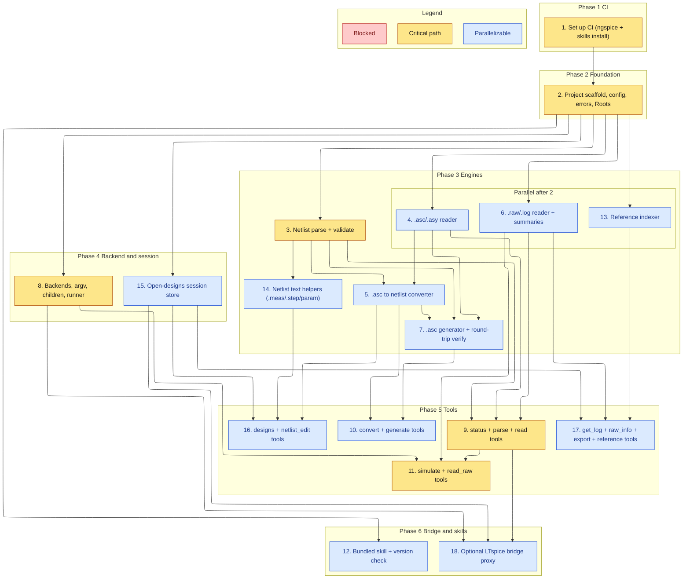

# Implementation Plan

Builds the OpenSPICE-MCP server bottom-up: shared safety core, then the engines (netlist, schematic, raw, text helpers, reference), then the backend runner and the open-designs session, then the MCP tool surface (including LTspice-parity tools), then the optional bridge proxy, then the bundled skill and its CI install check.

## Task graph

An arrow means depends-on. Primary critical path: 1, 2, 3, 8, 9, 11. CI (task 1) runs first and gates everything.

The critical path is the chain that delivers a working simulate-and-read loop: CI, foundation, the netlist model, the backend runner, the base tools, and the simulate/read_raw tools. The LTspice-parity tools (16, 17) and the optional bridge (18) build on that core.

## Tasks

- [ ] 1. Set up CI for build and test
  - Create `.github/workflows/ci.yml` (sibling-style): a `test` job on Node 22 running `npm ci`, `npm run build` (strict `tsc`), and `npm test`, plus a step that installs ngspice on the runner so the simulate smoke test runs against a real backend
  - Add a `skills` job that runs `node scripts/check-skill-versions.mjs skills` and installs the bundled skills into a throwaway `HOME` via `npx -y skills add "$GITHUB_WORKSPACE" -g -y`, asserting each skill reports `installed`
  - Keep a `release.yml` matching the sibling (tag `vX.Y.Z` gate, npm trusted publishing with provenance, GitHub release, GitHub Packages mirror)
  - Gates every later task: it must pass before task 2 starts

- [ ] 2. Scaffold the project and the safety core
  - Add `package.json` (`@sohampatwardhan/openspice-mcp`, bin `openspice-mcp`, deps `@modelcontextprotocol/sdk` + `zod` only), `tsconfig.json`, `AGENTS.md`, and `CLAUDE.md` mirroring the sibling repo
  - Implement `src/config.ts` (env vars `OPENSPICE_ROOTS`, `OPENSPICE_LTSPICE_BIN`, `OPENSPICE_NGSPICE_BIN`, `OPENSPICE_WINE_BIN`, `OPENSPICE_BRIDGE_BIN`, `OPENSPICE_ALLOW_PLOTS`, `OPENSPICE_ALLOW_BRIDGE`, `OPENSPICE_BACKEND_ORDER`, `OPENSPICE_LTSPICE_HELP_DIR`, timeouts, `LIMITS`), `src/errors.ts` (`ErrorCode` union incl. `GENERATE_UNVERIFIED`, `BRIDGE_UNAVAILABLE`, `DESIGN_NOT_FOUND`), and `src/paths.ts` (`Roots` with `realpath`, `resolveInside`, `ensureWritable`, `makeRunDir`, `snapshotDir`)
  - _Requirements: 8.1, 8.3, 8.4_

- [ ] 3. Implement the netlist parser and validator
  - `src/netlist.ts`: `parse(text)`, `validate(netlist)`, `emit(netlist)` with per-line diagnostics; resolve `.include`/`.lib` relative to the source dir and confine to roots at the tool layer
  - _Requirements: 2.1, 2.2, 2.3, 2.4, 2.5_

- [ ] 4. Implement the .asc/.asy reader
  - `src/asc.ts`: `readAsc(bytes)` and `readAsy(bytes)` with UTF-16/UTF-8(+BOM)/CRLF decoding and detected-encoding reporting; model components, wires, flags, directives; retain unknown keywords as raw entries with a diagnostic
  - _Requirements: 3.1, 3.2, 3.3, 3.4_

- [ ] 5. Implement the schematic-to-netlist converter
  - In `src/asc.ts`: `toNetlist(schematic, symbols)` deriving nets from wire endpoints and labels, ordering nodes by symbol pin order, warnings for shorts/unconnected pins; reuse `netlist.emit`
  - _Requirements: 4.1, 4.2, 4.3, 4.4_

- [ ] 6. Implement the .raw and .log reader
  - `src/raw.ts`: `readRaw(bytes)` sniffing LTspice binary, ngspice binary, and ASCII; variables, point count, real/complex, step structure; `summarize(raw, vars, maxPoints)`; complex magnitude/phase; `parseMeas(log)`; `rawInfo(raw)` metadata-only; `exportWaveforms(raw, vars, path)` to CSV/ASCII; `RAW_PARSE_FAILED` on truncation/unknown header
  - _Requirements: 7.1, 7.2, 7.3, 7.4, 7.5, 7.6, 10.2, 10.3_

- [ ] 7. Implement the .asc generator with round-trip verification
  - `src/generate.ts`: `generateAsc(circuit)` with deterministic grid placement, orthogonal routing, ground flags on `0`/`GND`, net-label flags, on-sheet directives, `GENERATE_INVALID` rejection, and equivalent-netlist emit
  - Add the round-trip verifier: netlist the generated `.asc` via `toNetlist`, compare device set and net connectivity with the intended connectivity, return `verified` + counts or `GENERATE_UNVERIFIED` + diffs (error in strict mode)
  - _Requirements: 5.1, 5.2, 5.3, 5.4, 5.5, 5.6, 11.1, 11.2, 11.3_

- [ ] 8. Implement backends, fixed argv, child tracking, and the runner
  - `src/backends.ts` (probe/select ngspice + LTspice with path, version, mode), `src/argv.ts` (ngspice `-b`, LTspice `-b -Run`, Linux Wine wrap, and bridge argv; no shell, no free-form flags), `src/children.ts` (detached, tracked, `stopAll`), `src/runner.ts` (prepare run dir, spawn, timeout, classify exit into success/`SIM_FAILED`/`SIM_TIMEOUT`, clean up and stop processes)
  - Add fake executables (`test/fixtures/fake-backend.mjs`, `test/fixtures/fake-bridge.mjs`) selected via `OPENSPICE_*_BIN`/`OPENSPICE_BRIDGE_BIN` so tests never need a real simulator or bridge
  - _Requirements: 6.4, 6.5, 6.6, 6.7, 8.2, 8.5_

- [ ] 9. Add the status, parse-netlist, and read-schematic tools
  - `src/tools/status.ts` (`openspice_status`: backends, bridge availability/path/version, roots, default order, plotting + delegation flags, warnings), `src/tools/netlist.ts` (`openspice_parse_netlist`), `src/tools/schematic.ts` (`openspice_read_schematic`); strict input schemas, `outputSchema`, `structuredContent`; wire `Core`, `index.ts`, `server.ts`, shutdown
  - _Requirements: 1.1, 1.2, 1.3, 1.4, 1.5, 2.1, 2.2, 2.5, 3.1, 3.2_

- [ ] 10. Add the convert and generate tools
  - Extend `src/tools/schematic.ts` with `openspice_schematic_to_netlist` (text or write-to-roots, overwrite guard) and `openspice_generate_schematic` (write `.asc` + optional netlist, overwrite guard, `GENERATE_INVALID` passthrough, round-trip `verified`/`GENERATE_UNVERIFIED` result)
  - _Requirements: 4.4, 5.5, 5.6, 8.3, 11.2, 11.3_

- [ ] 11. Add the simulate and read-raw tools
  - `src/tools/simulate.ts` (`openspice_simulate`: netlist path/inline/`.asc`, convert `.asc` first, select backend, run, return status/paths/diagnostics), `src/tools/raw.ts` (`openspice_read_raw`: variables, summaries, measurements, optional plot)
  - `src/plot.ts`: `renderPlot(...)` writing an SVG inside a root only when plotting is enabled; a plotting-disabled request returns a diagnostic plus the numeric summary
  - _Requirements: 6.1, 6.2, 6.3, 7.1, 7.2, 7.3, 7.4, 7.5, 7.7_

- [ ] 12. Author the bundled skill and its version check
  - Add `skills/openspice/SKILL.md` (quoted SemVer `metadata.version`) teaching when and how to probe backends/bridge, open/edit designs, parse/validate, generate (with round-trip), simulate, read results/log, export, and look up reference docs, plus `references/` for a tool cheat sheet, the LTspice-parity map, and failure recovery
  - Add `scripts/check-skill-versions.mjs` (sibling-style) and confirm the task-1 `skills` CI job installs it cleanly
  - _Requirements: 1.1_

- [ ] 13. Implement the reference indexer
  - `src/refdoc.ts`: `list()` and `get(id)` over three tagged sources — the user's local `LTspiceHelp` folder when present and inside an allowed location, OpenSPICE's own bundled docs, and ngspice-manual pointers; read LTspice help only from the user's files; ship no ADI content
  - _Requirements: 13.1, 13.2, 13.3, 13.4_

- [ ] 14. Implement netlist text helpers
  - `src/edits.ts`: `addMeas(text, spec)`, `addStep(text, param, values)`, `parameterize(text, device, name)` operating on netlist text, each returning edited text or an absent-target diagnostic, never simulating
  - _Requirements: 12.1, 12.2, 12.3, 12.4_

- [ ] 15. Implement the open-designs session store
  - `src/designs.ts`: `open(path)`, `list()`, `active()`, `getContent(id)`, `setContent(id, text, {snapshot})` (validate -> optional snapshot -> write; parse error -> no write), `restore(id)`, `listChanged(cursor)`; associate each design with its latest `.raw`/`.log` for log and raw-info lookups
  - _Requirements: 9.1, 9.2, 9.3, 9.4, 9.5, 9.6, 10.1_

- [ ] 16. Add the designs and netlist-edit tools
  - `src/tools/designs.ts` (`openspice_designs`: open / list / active / get_content / set_content / snapshot / restore / list_changed; `DESIGN_NOT_FOUND`), and `openspice_netlist_edit` (`.meas`/`.step`/parameterize ops over text)
  - _Requirements: 9.1, 9.2, 9.3, 9.4, 9.5, 9.6, 12.1, 12.2, 12.3, 12.4_

- [ ] 17. Add the log, raw-info, export, and reference tools
  - `src/tools/raw.ts`/`src/tools/simulate.ts` additions: `openspice_get_log` (log text / parsed errors for a design or run, or no-log diagnostic), `openspice_raw_info` (metadata only), `openspice_export_waveforms` (CSV/ASCII inside roots, overwrite guard), and `src/tools/reference.ts` (`openspice_reference`: list / get)
  - _Requirements: 10.1, 10.2, 10.3, 10.4, 13.1, 13.2, 13.3_

- [ ] 18. Implement the optional LTspice bridge proxy
  - `src/bridge.ts`: detect `ltspice-mcp-bridge.exe` on Windows x64 (report availability/path/version via status); when `OPENSPICE_ALLOW_BRIDGE` is on, run it as an MCP client subprocess, forwarding supported ops (designs, netlist, simulate, log, raw/export, reference), `--headless` by default and `--pid`/`--port` (loopback) only on explicit live-GUI request; map exit/failure to `BRIDGE_UNAVAILABLE` and fall back to the file-based path
  - Add a `delegate` flag to the bridge-capable tools; keep file-based as the default on every platform; cover with `fake-bridge.mjs`
  - _Requirements: 1.5, 14.1, 14.2, 14.3, 14.4_
