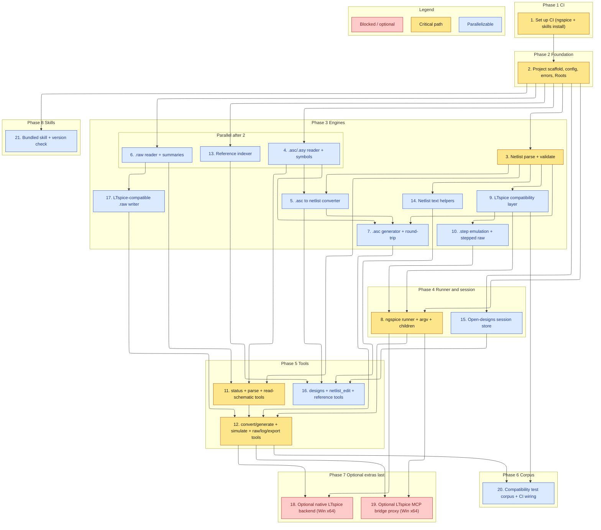

# Implementation Plan

Builds the OpenSPICE-MCP server bottom-up: safety core, engines (netlist, schematic, raw read/write, compatibility, step emulation, text helpers, reference), the ngspice runner and the open-designs session, the MCP tool surface, the compatibility test corpus, then the optional Windows-x64 extras (native LTspice backend, LTspice MCP bridge) last.

## Task graph

An arrow means depends-on. Primary critical path: 1, 2, 3, 8, 11, 12. CI (task 1) runs first and gates everything. The optional extras (18, 19) are last and never on the required path.

Critical path: CI, foundation, the netlist model, the ngspice runner, the base tools, and the combined convert/generate/simulate/raw tool task. The optional LTspice backend and bridge (18, 19) are styled blocked because they are not required.

## Tasks

- [ ] 1. Set up CI for build and test
  - Create `.github/workflows/ci.yml` (sibling-style): a `test` job on Node 22 running `npm ci`, `npm run build` (strict `tsc`), and `npm test`, with a step that installs **ngspice** on the runner so the simulate smoke test and the compatibility corpus run against a real engine
  - Add a `skills` job that runs `node scripts/check-skill-versions.mjs skills` and installs the bundled skills into a throwaway `HOME` via `npx -y skills add "$GITHUB_WORKSPACE" -g -y`, asserting each reports `installed`
  - Keep a `release.yml` matching the sibling (tag `vX.Y.Z` gate, npm trusted publishing with provenance, GitHub release, GitHub Packages mirror)
  - Gates every later task: it must pass before task 2 starts

- [x] 2. Scaffold the project and the safety core
  - Add `package.json` (`@sohampatwardhan/openspice-mcp`, bin `openspice-mcp`, deps `@modelcontextprotocol/sdk` + `zod` only), `tsconfig.json`, `AGENTS.md`, `CLAUDE.md` mirroring the sibling repo
  - Implement `src/config.ts` (env vars `OPENSPICE_ROOTS`, `OPENSPICE_NGSPICE_BIN`, `OPENSPICE_ALLOW_PLOTS`, `OPENSPICE_LTSPICE_HELP_DIR`, `OPENSPICE_SYMBOL_PATH`, plus the off-by-default `OPENSPICE_ENABLE_LTSPICE`, `OPENSPICE_LTSPICE_BIN`, `OPENSPICE_ENABLE_BRIDGE`, `OPENSPICE_BRIDGE_BIN`, `OPENSPICE_WINE_BIN`, timeouts, `LIMITS`), `src/errors.ts` (`ErrorCode` union incl. `UNSUPPORTED_LTSPICE_FEATURE`, `GENERATE_UNVERIFIED`, `BRIDGE_UNAVAILABLE`, `DESIGN_NOT_FOUND`), `src/paths.ts` (`Roots`: `realpath`, `resolveInside`, `ensureWritable`, `makeRunDir`, `snapshotDir`)
  - _Requirements: 8.1, 8.3, 8.4_

- [x] 3. Implement the netlist parser and validator
  - `src/netlist.ts`: `parse(text)`, `validate(netlist)`, `emit(netlist)` with per-line diagnostics; resolve `.include`/`.lib` relative to the source dir and confine to roots at the tool layer
  - _Requirements: 2.1, 2.2, 2.3, 2.4, 2.5_

- [x] 4. Implement the .asc/.asy reader and symbol resolution
  - `src/asc.ts`: `readAsc`/`readAsy` with UTF-16/UTF-8(+BOM)/CRLF decoding and detected-encoding reporting; model components, wires, flags, directives; retain unknown keywords as raw entries with a diagnostic
  - Ship a minimal open symbol set and resolve symbols from it, a configured `OPENSPICE_SYMBOL_PATH`, or the user's LTspice `sym` folder only when installed and inside an allowed location
  - _Requirements: 3.1, 3.2, 3.3, 3.4, 4.2_

- [x] 5. Implement the schematic-to-netlist converter
  - In `src/asc.ts`: `toNetlist(schematic, symbols)` deriving nets from wire endpoints and labels, ordering nodes by symbol pin order, warnings for shorts/unconnected pins; reuse `netlist.emit`
  - _Requirements: 4.1, 4.2, 4.3, 4.4_

- [ ] 6. Implement the .raw reader
  - `src/raw.ts`: `readRaw(bytes)` sniffing ngspice Berkeley binary/ASCII and LTspice binary (detect precision and `Flags:` from the header, not assumed); variables, point count, real/complex, step structure; `summarize(raw, vars, maxPoints)`; complex magnitude/phase; `parseMeas(log)`; `rawInfo(raw)` metadata-only; `exportWaveforms(raw, vars, path)` to CSV/ASCII; `RAW_PARSE_FAILED` on truncation/unknown header
  - _Requirements: 7.1, 7.2, 7.3, 7.4, 7.5, 7.6, 10.2, 10.3_

- [ ] 7. Implement the .asc generator with round-trip verification
  - `src/generate.ts`: `generateAsc(circuit)` with deterministic grid placement, orthogonal routing, ground flags on `0`/`GND`, net-label flags, on-sheet directives, LTspice-openable `.asc` bytes, `GENERATE_INVALID` rejection, equivalent-netlist emit
  - Round-trip verifier: netlist the generated `.asc`, compare device set and net connectivity with the intended connectivity, return `verified` + counts or `GENERATE_UNVERIFIED` + diffs (error in strict mode)
  - _Requirements: 5.1, 5.2, 5.3, 5.4, 5.5, 5.6, 11.1, 11.2, 11.3, 18.1_

- [ ] 8. Implement the ngspice runner, fixed argv, and child tracking
  - `src/ngspice.ts` (probe ngspice: path, version, whether it supports `ngbehavior=lt`, recording the stated minimum and marking it uncertain), `src/argv.ts` (ngspice `-b -r <raw> -o <log>`; no shell, no free-form flags), `src/children.ts` (detached, tracked, `stopAll`), `src/runner.ts` (prepare run dir, write the per-run `.spiceinit`/control block via the compat layer, spawn, enforce timeout, classify exit into success/`SIM_FAILED`/`SIM_TIMEOUT`, clean up and stop processes)
  - Add `test/fixtures/fake-ngspice.mjs` selected via `OPENSPICE_NGSPICE_BIN` so tests never need a real engine
  - _Requirements: 6.1, 6.4, 6.5, 6.6, 6.7, 8.2, 8.5, 8.6_

- [ ] 9. Implement the LTspice compatibility layer
  - `src/compat.ts`: build the per-run `.spiceinit`/control block (`set ngbehavior=lt`; add `ltps`/`ltpsa` when PSpice-style libraries appear), never touching the user's global config; detect LTspice-only constructs from the parsed netlist, translate the safe ones (recording each translation), and raise `UNSUPPORTED_LTSPICE_FEATURE` naming the construct and 1-based line otherwise, per the design's compatibility table; require open user-supplied models for encrypted/vendor libs; resolve LTspice `standard.*` libs from the user's install when present and allowed
  - _Requirements: 15.1, 15.2, 15.3, 15.4, 15.5_

- [ ] 10. Implement .step emulation and stepped-raw assembly
  - `src/steps.ts`: expand `.step`/`.param` into an ngspice control loop (`alter`/`let`/`foreach`), collect per-step results, and assemble a single stepped `.raw`/result the reader keys by step index
  - _Requirements: 6.3, 7.3_

- [ ] 11. Add the status, parse-netlist, and read-schematic tools
  - `src/tools/status.ts` (`openspice_status`: ngspice path/version/compat-mode support with warnings, roots, plotting flag, optional-extras availability), `src/tools/netlist.ts` (`openspice_parse_netlist`), `src/tools/schematic.ts` (`openspice_read_schematic`); strict schemas, `outputSchema`, `structuredContent`; wire `Core`, `index.ts`, `server.ts`, shutdown
  - _Requirements: 1.1, 1.2, 1.3, 2.1, 2.2, 2.5, 3.1, 3.2_

- [ ] 12. Add the convert/generate, simulate, and raw/log/export tools
  - Extend `src/tools/schematic.ts` with `openspice_schematic_to_netlist` (text or write-to-roots, overwrite guard) and `openspice_generate_schematic` (write `.asc` + optional netlist, overwrite guard, `GENERATE_INVALID` passthrough, round-trip `verified`/`GENERATE_UNVERIFIED`)
  - `src/tools/simulate.ts` (`openspice_simulate`: netlist path/inline/`.asc`, convert `.asc` first, run ngspice through the compat layer and step emulator, return status/paths/diagnostics/translations; `UNSUPPORTED_LTSPICE_FEATURE` passthrough), `src/tools/raw.ts` (`openspice_read_raw`, `openspice_raw_info`, `openspice_export_waveforms`, `openspice_get_log`)
  - `src/plot.ts`: `renderPlot(...)` writing an SVG only when plotting is enabled; a plotting-disabled request returns a diagnostic plus the numeric summary
  - _Requirements: 4.4, 5.5, 5.6, 6.1, 6.2, 7.1, 7.2, 7.4, 7.5, 7.7, 8.3, 10.1, 10.4, 11.2, 11.3, 15.3_

- [ ] 13. Implement the reference indexer
  - `src/refdoc.ts`: `list()`/`get(id)` over OpenSPICE's own bundled docs, ngspice-manual pointers, and the user's local `LTspiceHelp` folder only when present and inside an allowed location; read LTspice help only from the user's files; ship no ADI content
  - _Requirements: 13.1, 13.2, 13.3, 13.4_

- [ ] 14. Implement netlist text helpers
  - `src/edits.ts`: `addMeas(text, spec)`, `addStep(text, param, values)`, `parameterize(text, device, name)` over netlist text, each returning edited text or an absent-target diagnostic, never simulating
  - _Requirements: 12.1, 12.2, 12.3, 12.4_

- [ ] 15. Implement the open-designs session store
  - `src/designs.ts`: `open`, `list`, `active`, `getContent`, `setContent` (validate -> optional snapshot -> write in LTspice-openable bytes; parse error -> no write), `restore`, `listChanged(cursor)`; associate each design with its latest `.raw`/`.log`
  - _Requirements: 9.1, 9.2, 9.3, 9.4, 9.5, 9.6, 10.1_

- [ ] 16. Add the designs, netlist-edit, and reference tools
  - `src/tools/designs.ts` (`openspice_designs`: open/list/active/get_content/set_content/snapshot/restore/list_changed; `DESIGN_NOT_FOUND`), `openspice_netlist_edit` (`.meas`/`.step`/parameterize), `src/tools/reference.ts` (`openspice_reference`: list/get)
  - _Requirements: 9.1, 9.2, 9.3, 9.4, 9.5, 9.6, 12.1, 12.2, 12.3, 12.4, 13.1, 13.2, 13.3_

- [ ] 17. Implement the LTspice-compatible .raw writer
  - `src/rawwrite.ts`: convert an ngspice result into an LTspice binary `.raw` (UTF-16LE header, `Flags:` real/complex/double/stepped/forward, variable list, trace widths per the design's fidelity notes with each uncertain detail tagged) while keeping ngspice's original beside it; verify fidelity by re-reading the written file with `raw.readRaw` and comparing variables/points/values within tolerance; on failure return the ngspice-native artifact plus a diagnostic
  - _Requirements: 18.2, 18.3, 18.4_

- [ ] 18. (optional) Add the native LTspice simulation backend (Windows x64)
  - `src/ltspice.ts`: on Windows x64, detect a native LTspice executable (report via status); when `openspice_simulate backend: ltspice` is enabled and available, run native LTspice batch via fixed argv and return the same result shape; never required, never the default
  - _Requirements: 1.4, 16.1, 16.2, 16.3_

- [ ] 19. (optional) Add the LTspice MCP bridge proxy (Windows x64)
  - `src/bridge.ts`: detect `ltspice-mcp-bridge.exe` on Windows x64 (report via status); when `OPENSPICE_ENABLE_BRIDGE` is on, run it as an MCP client subprocess, forwarding supported ops `--headless` by default and `--pid`/`--port` (loopback) only on explicit live-GUI request; map exit/failure to `BRIDGE_UNAVAILABLE` and fall back to the ngspice file-based path. Add a `delegate` flag to bridge-capable tools; keep file-based as the default. Cover with `test/fixtures/fake-bridge.mjs`
  - _Requirements: 1.4, 17.1, 17.2, 17.3, 17.4_

- [ ] 20. Build the compatibility test corpus and wire it into CI
  - Create `test/corpus/<case>/` fixtures (`input.cir`/`input.asc`, `expected.net`, optional `expected.meas.json` with tolerances, `notes.md`), a runner that parses, netlists, runs ngspice through the compat layer, and compares within tolerance, plus cases for each newly supported/translated or unsupported construct; run it in the task-1 CI `test` job. Leave room for the owner's undergrad LTspice circuits
  - _Requirements: 14.1, 14.2, 14.3, 14.4_

- [ ] 21. Author the bundled skill and its version check
  - Add `skills/openspice/SKILL.md` (quoted SemVer `metadata.version`) teaching probing, open/edit designs, parse/validate, generate (round-trip), simulate with ngspice + compatibility, read results/log, export, LTspice-compatible raw, and reference lookup, noting the LTspice backend and bridge as optional Windows-x64 extras, plus `references/` for a tool cheat sheet, the parity map, the compatibility table, and failure recovery
  - Add `scripts/check-skill-versions.mjs` (sibling-style) and confirm the task-1 `skills` CI job installs it cleanly
  - _Requirements: 1.1_
