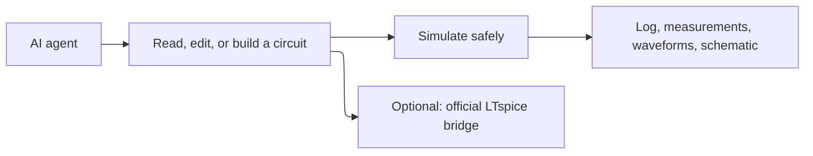

# Product

## Purpose

OpenSPICE-MCP is an MCP server that lets an AI agent work with SPICE circuits through typed tools: open/list designs and read or edit their content, parse and validate SPICE netlists and LTspice schematics, convert a schematic to a netlist, generate a readable LTspice `.asc` from a structured description (verified by round-trip), run simulations on LTspice or ngspice, read the SPICE log and `.raw` results, export and optionally plot waveforms, apply `.meas`/`.step`/parameterize helpers, list changes, and answer LTspice/ngspice how-to questions. It is the SPICE sibling of `kiro-mcp-server` and follows its conventions.

It targets feature parity with Analog Devices' official LTspice MCP server (LTspice 26.1.1, `ltspice-mcp-bridge.exe`), which is Windows-x64 only and GUI-bound. OpenSPICE delivers those capabilities cross-platform and file-based, and can optionally delegate to the official bridge when it is present.

## Users

For agents (and the engineers behind them) that need circuit analysis without driving a simulator GUI by hand, on any platform. Not a replacement for LTspice or ngspice themselves.

## Objectives

When a trade-off appears, prefer: safety and confinement over convenience (no shell, paths inside roots, processes tracked and killed); cross-platform file-based operation over GUI coupling (the official bridge is optional, never required); correctness over partial results (a failed run is an error; a generated schematic is never called verified unless its connectivity round-trips); lean output over completeness (summaries and bounded samples over raw dumps); portability over backend breadth (ngspice everywhere, LTspice where the host supports it, bridge only on Windows x64).

## In scope

- Open/list designs and get/set content as files; snapshot/undo; list changes
- Parse/validate SPICE netlists and read LTspice `.asc`/`.asy`
- Convert `.asc` to a netlist; generate `.asc` from a description with round-trip verification
- `.meas`/`.step`/parameterize text helpers
- Run `op`/`tran`/`ac`/`dc`/`noise` with `.step`/`.meas` on LTspice or ngspice; read the SPICE log
- Parse `.raw` (binary/ASCII, real/complex, stepped): raw info, summaries, measurements, CSV export, optional plots
- Reference lookup from the user's local LTspiceHelp, OpenSPICE docs, and ngspice pointers
- Optional delegation to `ltspice-mcp-bridge.exe` on Windows x64

## Out of scope

- GUI schematic editing
- Monte Carlo / worst-case orchestration beyond passing through `.step`
- Bundling or redistributing Analog Devices' LTspice documentation
- Arbitrary shell execution
