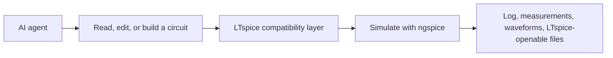

# Product

## Purpose

OpenSPICE-MCP is an MCP server that lets an AI agent work with SPICE circuits through typed tools: open/list designs and read or edit their content, parse and validate SPICE netlists and LTspice schematics, convert a schematic to a netlist, generate a readable LTspice-openable `.asc` from a structured description (verified by round-trip), run simulations with ngspice, read the SPICE log and `.raw` results, export and optionally plot waveforms, apply `.meas`/`.step`/parameterize helpers, list changes, and answer how-to questions. It is the SPICE sibling of `kiro-mcp-server` and follows its conventions.

ngspice is the one required engine, on every platform and in CI. LTspice is the format inspiration, not a dependency: files OpenSPICE writes must open in LTspice, but circuits are simulated with ngspice in its LTspice compatibility mode. A native LTspice backend and a proxy to ADI's official LTspice MCP bridge are optional Windows-x64 extras, never required.

## Users

For agents (and the engineers behind them) that need circuit analysis without driving a simulator GUI by hand, on any platform. Not a replacement for ngspice or LTspice themselves.

## Objectives

When a trade-off appears, prefer: safety and confinement over convenience (no shell, paths inside roots, processes tracked and killed, no edits to the user's global config); one required engine over many (ngspice everywhere; LTspice and the bridge are optional, secondary, Windows-x64 only); file-format fidelity (what OpenSPICE writes opens in LTspice); correctness over silent divergence (an LTspice-only construct is translated when safe or fails with a clear reason, never run as a silently different circuit; a generated schematic is never called verified unless its connectivity round-trips); accuracy over guessing (format and compatibility details not yet confirmed are marked uncertain and pinned by the test corpus); lean output over completeness (summaries and bounded samples over raw dumps).

## In scope

- Open/list designs and get/set content as files; snapshot/undo; list changes
- Parse/validate SPICE netlists and read LTspice `.asc`/`.asy`
- Convert `.asc` to a netlist; generate LTspice-openable `.asc` with round-trip verification
- `.meas`/`.step`/parameterize text helpers
- Run `op`/`tran`/`ac`/`dc`/`noise` with ngspice (LTspice compatibility mode); `.step` emulation; read the SPICE log
- Parse `.raw`: raw info, summaries, measurements, CSV export, optional plots, LTspice-compatible raw writer
- Reference lookup from OpenSPICE docs, ngspice pointers, and the user's local LTspiceHelp
- Optional, never-required Windows-x64 extras: native LTspice backend and LTspice MCP bridge

## Out of scope

- GUI schematic editing
- Monte Carlo / worst-case orchestration beyond `.step`
- Running or redistributing encrypted/proprietary vendor model libraries
- Bundling or redistributing Analog Devices' LTspice documentation
- Arbitrary shell execution; editing the user's global simulator config
