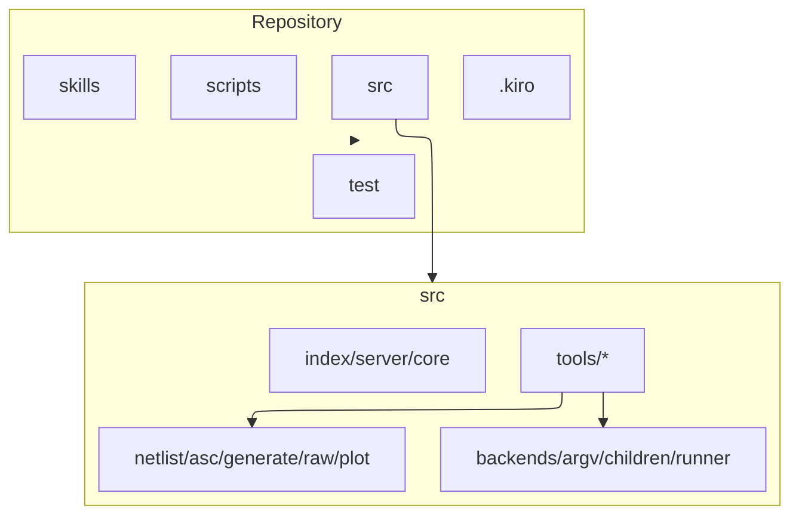

# Project structure

## Layout

`src/` holds the server and engine; `test/` the smoke and unit tests with a fake-backend fixture; `skills/` the bundled agent skill; `scripts/` the skill-version check; `.github/workflows/` the CI and release workflows; `.kiro/` the specs and steering. Within `src/`: `index.ts` (entry, config load, shutdown), `server.ts` (composition root), `core.ts` (the `Core` bundle), `config.ts`, `errors.ts`, `paths.ts`; the engine modules `netlist.ts`, `asc.ts`, `generate.ts`, `raw.ts`, `plot.ts`; the process layer `backends.ts`, `argv.ts`, `children.ts`, `runner.ts`; and one file per tool group under `src/tools/`.

## Naming and imports

- Double quotes, semicolons, trailing commas, 2-space indent. Relative imports carry `.js` extensions (ESM).
- Tools call engine and process modules; engine and process modules never import tools. Backend argv lives only in `argv.ts`; process spawning only in `children.ts`; path checks only in `paths.ts`.
- A new tool needs a spec change (requirement + design), a strict schema, an `outputSchema`, smoke coverage, and any new error code added to the `ErrorCode` union and the README table.

## Specs and steering

- Specs: `.kiro/specs/<feature-name>/`
- Steering: `.kiro/steering/`
- Hooks: `.kiro/hooks/`
