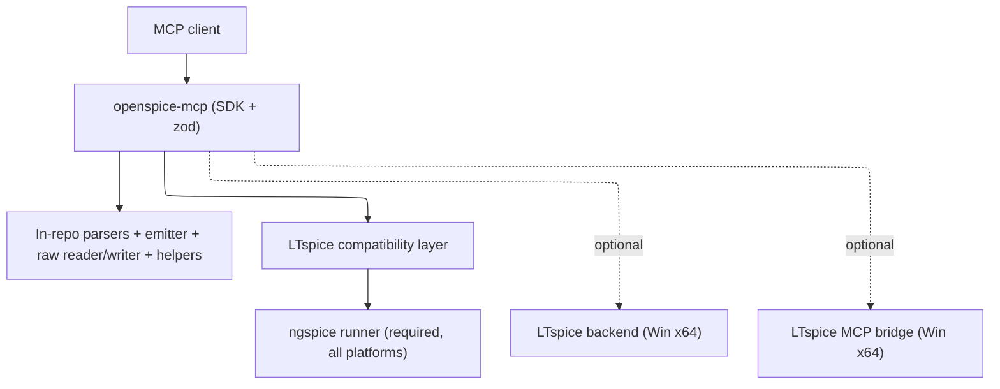

# Technology stack

## Runtime

TypeScript, ESM, Node.js 20+. Strict `tsc` (`noUncheckedIndexedAccess`, `noImplicitOverride`) is the static check; there is no separate lint script. MCP surface uses `@modelcontextprotocol/sdk`; schemas use `zod`. Those two are the only runtime dependencies — parsers, codecs, the `.asc` emitter, the LTspice-compatible `.raw` writer, and the text helpers are written in-repo. Published as `@sohampatwardhan/openspice-mcp`, run with `npx -y @sohampatwardhan/openspice-mcp@latest`.

## Simulation engine

**ngspice is the sole required simulation engine**, on Windows (x64 and ARM64), macOS, and Linux, and in CI. LTspice was the inspiration for the file formats, not a runtime dependency. LTspice-flavoured netlists (and netlists converted from `.asc`) run under ngspice's LTspice compatibility mode: `set ngbehavior=lt` (plus the `ltps`/`ltpsa` variants when PSpice-style libraries are pulled in), written into a per-run `.spiceinit`/control block the server controls — never the user's global config. Minimum ngspice version for compatibility mode is stated as **34+ (uncertain; verify against the ngspice manual for the host)** and reported by the status tool.

## File-format fidelity (hard requirement)

Files OpenSPICE writes must open in LTspice even though simulation uses ngspice:

- `.asc`/`.asy`: written in LTspice's line-based keyword grammar with LTspice's encoding/line-ending convention (CRLF; UTF-16LE vs UTF-8 varies by LTspice build — treated as **uncertain** and recorded per write).
- `.raw`: ngspice produces a Berkeley rawfile (ASCII header, `set filetype=binary|ascii`, IEEE-754 payload whose precision is read from the header). When an LTspice-openable result is wanted, the server also writes an LTspice binary `.raw` (UTF-16LE header, `Flags: real/complex/double/stepped/forward`, float64 time axis + float32 traces for a real transient — **uncertain** field widths per analysis) and keeps ngspice's original. Every LTspice-compatible raw is round-trip-verified by re-reading it with our own parser; if a reliable one cannot be produced, the ngspice-native artifact is returned with a diagnostic.

Any format or compatibility detail not yet confirmed against real LTspice files is marked **uncertain** and pinned by the compatibility test corpus rather than guessed.

## Optional extras (Windows x64, off by default, last)

A native LTspice simulation backend and a proxy to ADI's official `ltspice-mcp-bridge.exe` are optional, Windows-x64-only, and never required. The bridge runs `--headless` by default and attaches to an open GUI (`--pid`/`--port`, loopback) only when the caller explicitly asks. Off Windows x64 the status tool reports both unavailable with a reason.

## Constraints

- No shell tool, no raw argv, no free-form flag field. Command vectors are built in one module (`argv.ts`); children are spawned detached, `shell: false`, tracked, group-killed (`children.ts`).
- Every path goes through `Roots` (`realpath`) before any read, write, or spawn; outputs refuse to overwrite unless asked. Compatibility settings go in a per-run file, never the user's global `.spiceinit`.
- LTspice-only constructs ngspice cannot run identically are translated when safe, else fail with `UNSUPPORTED_LTSPICE_FEATURE` naming the construct and line. `.step` is emulated with an ngspice control loop and a stepped raw.
- The `.asc` generator round-trips its output (netlist it, compare connectivity) and never presents an unverified schematic as verified.
- Tools have strict input schemas (`additionalProperties: false`), an `outputSchema`, and return `structuredContent`; errors are `{ error: { code, message, details } }`.
- Config env vars: `OPENSPICE_ROOTS`, `OPENSPICE_NGSPICE_BIN`, `OPENSPICE_ALLOW_PLOTS`, `OPENSPICE_LTSPICE_HELP_DIR`, `OPENSPICE_SYMBOL_PATH`, and the off-by-default `OPENSPICE_ENABLE_LTSPICE`/`OPENSPICE_LTSPICE_BIN`, `OPENSPICE_ENABLE_BRIDGE`/`OPENSPICE_BRIDGE_BIN`, `OPENSPICE_WINE_BIN`.
- Tests never require a real LTspice or the bridge; ngspice or fake fixtures run in CI. A compatibility corpus with golden expectations and tolerances runs in CI. Plotting and the extras are off by default.

