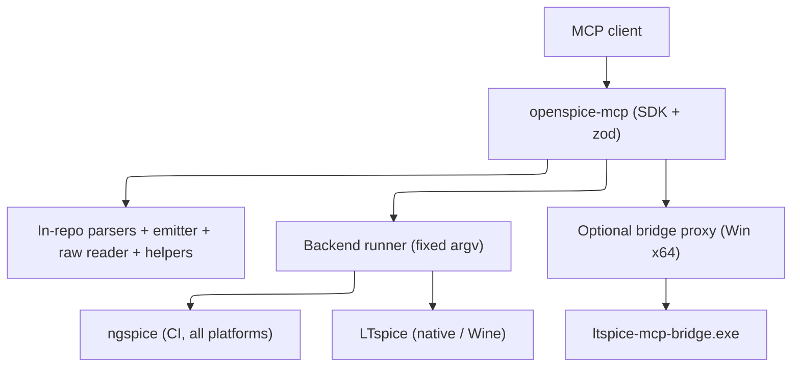

# Technology stack

## Runtime

TypeScript, ESM, Node.js 20+. Strict `tsc` (`noUncheckedIndexedAccess`, `noImplicitOverride`) is the static check; there is no separate lint script. MCP surface uses `@modelcontextprotocol/sdk`; schemas use `zod`. Those two are the only runtime dependencies — parsers, codecs, the `.asc` emitter, and the text helpers are written in-repo. Published as `@sohampatwardhan/openspice-mcp`, run with `npx -y @sohampatwardhan/openspice-mcp@latest`.

## Parity target and integrations

OpenSPICE-MCP targets feature parity with Analog Devices' official LTspice MCP server (LTspice 26.1.1, `ltspice-mcp-bridge.exe`, help page `Third_Party_AI_Tools.htm`) while working cross-platform and file-based. The parity table and tool mapping live in `design.md`.

No database. External integrations are the simulation backends and the optional bridge only:

- ngspice (open source; Linux/macOS/Windows; the CI backend; fully supported everywhere).
- LTspice: Windows native `-b` batch; Linux via Wine; the native macOS app with weaker batch support (best-effort).
- Optional delegation: on **Windows x64** with LTspice >= 26.1.1, `ltspice-mcp-bridge.exe` can be driven as an MCP client subprocess (`--headless` by default; `--pid`/`--port` loopback attach for live-GUI edits that enter LTspice's undo history; `--ltspice-path`/`LTSPICE_INSTALL_DIR`; `--list`). Never required; the file-based path is always the default.

File formats handled in-repo: SPICE netlists, LTspice `.asc`/`.asy`, and `.raw`/`.log` results. Format knowledge is credited to spicelib / PyLTSpice (Nuno Brum) and the ngspice manual; no code is copied and no ADI documentation is bundled.

## Platform notes

- The official LTspice MCP is in the **Windows x64** build only (26.1.1). The native **Windows ARM64** build (`LTspice64_arm.msi`) and the **macOS** build (`LTspice_26.pkg`, macOS 10.15+, so current macOS such as macOS 27 installs it) are still **26.0.2 with no MCP**. The x64 MSI refuses to install on Windows ARM64, and the extracted x64 exe will not start under emulation there. Bridge delegation is therefore Windows-x64 only; elsewhere the status tool reports it unavailable with a reason.
- LTspice batch simulation: strong on Windows, available on Linux via Wine, best-effort on the native macOS app. macOS 27 is fine for the macOS LTspice pkg and for ngspice with no special handling beyond marking macOS LTspice batch best-effort.

## Constraints

- No shell tool, no raw argv, no free-form flag field. Backend and bridge command vectors are built in one module (`argv.ts`); children are spawned detached, `shell: false`, tracked, and group-killed (`children.ts`).
- Every path goes through `Roots` (`realpath`) before any read, write, or spawn; outputs refuse to overwrite unless asked. Open designs are an in-memory file-based session; `set_content` validates before writing and can snapshot for undo.
- The `.asc` generator round-trips its output (netlist it, compare connectivity) and never presents an unverified schematic as verified — the answer to ADI's "AI draws schematics poorly" caveat.
- Tools have strict input schemas (`additionalProperties: false`), an `outputSchema`, and return `structuredContent`; errors are `{ error: { code, message, details } }`.
- Config env vars include `OPENSPICE_ROOTS`, `OPENSPICE_NGSPICE_BIN`, `OPENSPICE_LTSPICE_BIN`, `OPENSPICE_WINE_BIN`, `OPENSPICE_BRIDGE_BIN`, `OPENSPICE_ALLOW_BRIDGE`, `OPENSPICE_ALLOW_PLOTS`, `OPENSPICE_BACKEND_ORDER`, `OPENSPICE_LTSPICE_HELP_DIR`.
- Tests never require a real LTspice or the real bridge; ngspice or fake backend/bridge fixtures run in CI. Plotting and bridge delegation are off by default.

