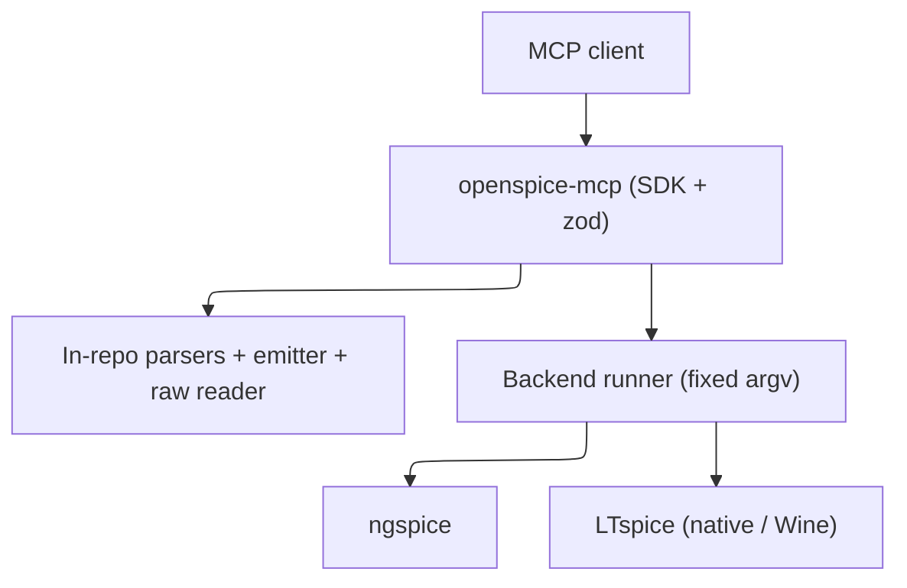

# Technology stack

## Runtime

TypeScript, ESM, Node.js 20+. Strict `tsc` (`noUncheckedIndexedAccess`, `noImplicitOverride`) is the static check; there is no separate lint script. MCP surface uses `@modelcontextprotocol/sdk`; schemas use `zod`. Those two are the only runtime dependencies — parsers, codecs, and the `.asc` emitter are written in-repo. Published as `@sohampatwardhan/openspice-mcp`, run with `npx -y @sohampatwardhan/openspice-mcp@latest`.

## Data and integrations

No database. External integrations are the simulation backends only: ngspice (open source; Linux/macOS; the CI backend) and LTspice (Windows native `-b` batch; macOS native app with weaker batch support; Linux via Wine). File formats handled in-repo: SPICE netlists, LTspice `.asc`/`.asy`, and `.raw`/`.log` results. Format knowledge is credited to spicelib / PyLTSpice (Nuno Brum) and the ngspice manual; no code is copied.

## Constraints

- No shell tool, no raw argv, no free-form flag field. Backend command vectors are built in one module (`argv.ts`); children are spawned detached, `shell: false`, tracked, and group-killed.
- Every path goes through `Roots` (`realpath`) before any read, write, or spawn; outputs refuse to overwrite unless asked.
- Tools have strict input schemas (`additionalProperties: false`), an `outputSchema`, and return `structuredContent`; errors are `{ error: { code, message, details } }`.
- Tests never require a real LTspice; ngspice or a fake backend fixture runs in CI. Plotting is off by default.

